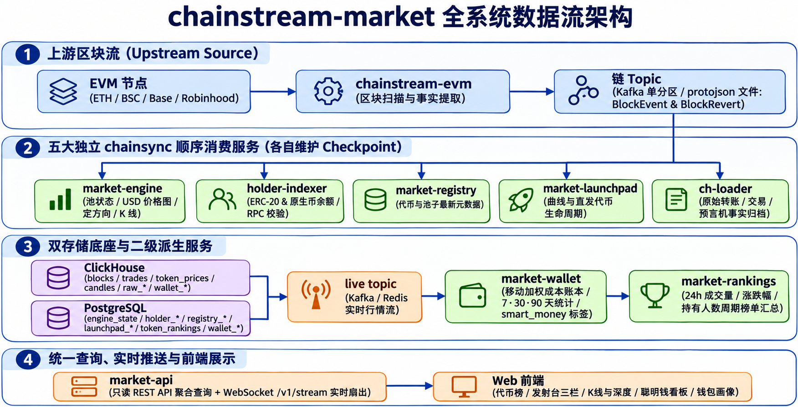

# chainstream-market 中文文档

`chainstream-market` 是建立在 [chainstream-evm](https://github.com/AloneAtWar/chainstream-evm) 区块流之上的一组市场数据服务：给交易定方向（base/quote）、USD 定价、K 线、持有人余额、原始转账、代币排行榜、钱包盈亏与聪明钱标签，以及一个 Web 前端。目前覆盖 ETH、BSC、Base 和 Robinhood Chain。

`chainstream-evm` 只发布链上“事实”（每块的交易、转账、资产、池子、预言机日志……），本仓库负责所有“派生”计算。

## 文档目录

| 文档 | 内容 |
| --- | --- |
| [components/README.md](components/README.md) | **八个组件的独立手册**：基本流程、核心流程、逐表逐字段字典、设计巧思、一致性与边界 |
| [architecture.md](architecture.md) | 整体四层数据流、八个组件的职责、双库表所有权矩阵、目录结构与 `depguard` 分层、共享顺序消费循环（`chainsync`） |
| [reorg-consistency.md](reorg-consistency.md) | **全链路区块重组（Reorg）专题**：上游分叉检测、八大组件回滚与崩溃恢复矩阵、PG 三类 Undo 与 CH 多时间线删除范式 |
| [market-engine.md](market-engine.md) | **定价与 K 线深度专题**：池子状态、价格图与 `beats` 深度选池推演、交易定方向、集中流动性 tick 表、Chainlink、异常交易、迟到小数位与双高度回填 |
| [holder-balances.md](holder-balances.md) | **持有人余额深度专题**：完整 DDL、初始化、增量、对账、回滚、`exact`/`latest` 链上读取及块哈希与最终性边界 |
| [wallet-ledger.md](wallet-ledger.md) | **钱包成本账本与聪明钱专题**：移动加权平均成本法完整数值推演、Live 分片与 CH 补缺、跨库崩溃恢复与两阶段 Invalidation、三坐标增量日汇总 |
| [services.md](services.md) | 七个服务的集中说明：`market-api` 接口、实时推送协议及各消费 / 汇总服务 |
| [operations.md](operations.md) | 本地完整环境、Docker Compose 部署拓扑、**新增一条链接入清单**、ClickHouse TTL 冷热分层生命周期、指标与**运维排障手册**、Web 前端 |

## 逐组件手册

| 组件 | 手册 | 深度专题 | 主要问题 |
| --- | --- | --- | --- |
| `market-engine` | [行情派生核心](components/market-engine.md) | [定价与 K 线深度专题](market-engine.md) | 原始池操作怎样变成 USD 价格、定向交易与可回滚 K 线 |
| `ch-loader` | [原始事实归档](components/ch-loader.md) | [全链路重组一致性](reorg-consistency.md) | 原始事实怎样批量落 ClickHouse，崩溃后怎样幂等重放 |
| `holder-indexer` | [持有人余额与人数](components/holder-indexer.md) | [持有人余额深度专题](holder-balances.md) | 历史余额、latest 超前读取、对账和重组怎样统一 |
| `market-registry` | [代币与池子元数据](components/market-registry.md) | [全链路重组一致性](reorg-consistency.md) | 多标准探测、迟到旧观察和部署证据怎样合并 |
| `market-launchpad` | [发射平台生命周期](components/market-launchpad.md) | [全链路重组一致性](reorg-consistency.md) | 曲线与直发代币怎样支撑新币 / 发射中 / 已迁移三栏 |
| `market-rankings` | [代币榜单读模型](components/market-rankings.md) | [全链路重组一致性](reorg-consistency.md) | 24h 榜单怎样以链头为窗口并增量跟上重组 |
| `market-wallet` | [钱包账本与标签](components/market-wallet.md) | [钱包账本与聪明钱专题](wallet-ledger.md) | 移动加权成本、live 分片补缺、版本化统计怎样协作 |
| `market-api` | [统一查询与实时推送](components/market-api.md) | [运行与前端对接](operations.md) | 各读模型如何服务 REST，历史与 WebSocket 怎样一致合并 |

英文版完整说明见仓库根目录 [README.md](../../README.md)；行为、字段和默认值最终以当前代码与 DDL 为准。

## 一张图看懂



```text
                      chainstream-evm（每条链一个进程）
                                │  stream.v1.StreamRecord（BlockEvent / BlockRevert）
                                ▼
                 Kafka topic（单分区）或 protojson 行文件
        ┌──────────────┬───────────────┼────────────────┬──────────────────┬──────────────────┐
        ▼              ▼               ▼                ▼                  ▼                  │
  market-engine   holder-indexer   market-registry  market-launchpad   ch-loader              │
  定方向/定价/K线  持有人余额        代币与池子元数据  发射台生命周期      原始事实入库            │
        │              │               │                │                  │                  │
        ▼              ▼               ▼                ▼                  ▼                  │
   ClickHouse      PostgreSQL       PostgreSQL       PostgreSQL       ClickHouse              │
  trades/prices/   holder_*        registry_*       launchpad_*        raw_*                  │
  candles                                                                                     │
        │  live topic（Kafka / Redis）        market-rankings（定期汇总 → token_rankings）      │
        │        └─► market-wallet（持仓账本、钱包统计、聪明钱标签）                              │
        ▼                                                │                                    │
     market-api（REST + WebSocket /v1/stream） ◄─────────┴────────────────────────────────────┘
        │
        ▼
     web 前端（React + Vite）
```

每个消费组件都**各自**按 offset 顺序读同一条链 topic、各自维护检查点，互不依赖；任何一个落后或重启都不影响其它组件。

## 快速开始

```sh
cp deploy/.env.example deploy/.env   # 设置 ETH_RPC_URL
make up                              # 用 docker compose 启动全部服务
open http://localhost:8088           # Web 前端
```

需要 Docker Compose v2、一个 ETH 节点，以及与本仓库并列的 `chainstream-evm` 代码目录。详见 [operations.md](operations.md)。
