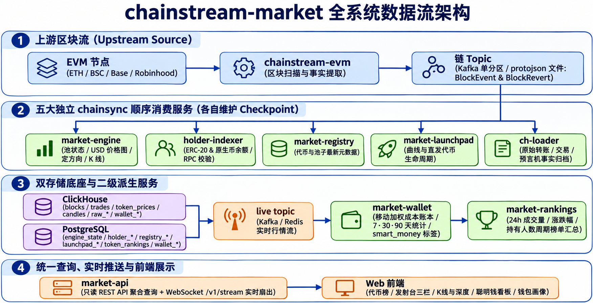
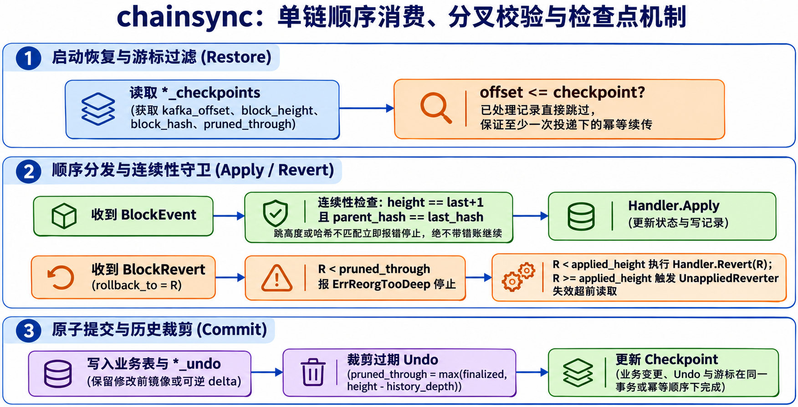
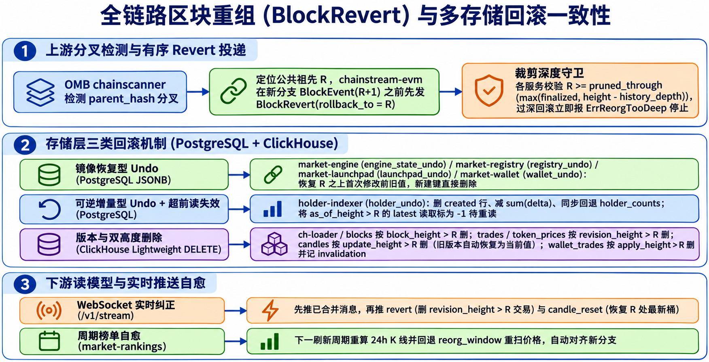

# 架构说明

`chainstream-market` 是一套建立在 `chainstream-evm` 链上事实流之上的**低延迟、可回滚多链市场数据派生与查询系统**。它将上游单一职责的区块事实流（`BlockEvent` / `BlockRevert`）拆分为多个独立消费、互不阻塞的派生组件，通过 ClickHouse 与 PostgreSQL 双存储底座协同，向前端与第三方调用方提供 REST 查询和 WebSocket 实时推送。



---

## 1. 四层数据流与八大组件职责

全系统自上而下分为四层：

1. **上游区块流层（Upstream Source）**：`chainstream-evm` 扫描 EVM / TRON 节点，提取原始池子操作、ERC-20 转账、原生币触达地址、资产与池子元数据、预言机更新和发射台事件，按块顺序写入单分区 Kafka Topic 或 protojson 行文件。
2. **一级顺序消费层（`chainsync` Consumers）**：五个独立进程（`market-engine`、`holder-indexer`、`market-registry`、`market-launchpad`、`ch-loader`）各自维护检查点、按 offset 顺序消费同一条链 Topic。**任何一个组件重启、落后或回放都不阻塞其它组件。**
3. **双存储与二级派生层（Storage & Secondary Processors）**：
   - `market-wallet` 跟读 `market-engine` 产出的实时派生流（`{topic}-live`），在 ClickHouse `trades` 表配合下维护移动加权成本账本与周期统计标签；
   - `market-rankings` 周期性跨库联读 ClickHouse（24h K 线、最新价格）与 PostgreSQL（持有人数、部署时间），生成单表带索引的 `token_rankings` 读模型。
4. **聚合查询与展示层（Serving & Web UI）**：`market-api` 聚合所有读模型提供无状态 REST 接口，并通过内部 Hub 将 live topic 扇出至 WebSocket 客户端（`/v1/stream`），支撑 `web/` 前端的六大业务视图。

### 1.1 八大组件总览

每个命令（`cmd/<命令>`）对应一个独立组件（`internal/app/<组件>`）：

| 命令 | 组件目录 | 输入数据源 | 写入存储 / 通道 | 核心职责 | 组件手册 |
| --- | --- | --- | --- | --- | --- |
| `market-engine` | `engine` | 链 Topic、EVM RPC（Chainlink）、CH `raw_trades`（回填） | CH（`blocks`、`trades`、`token_prices`、`candles`）、PG（`engine_*` 状态，可选）、live topic | 池状态维护、USD 价格图、交易定方向、K 线、集中流动性深度 | [components/market-engine.md](components/market-engine.md) |
| `ch-loader` | `loader` | 链 Topic | CH（`raw_transfers`、`raw_trades`、`oracle_updates`、`asset_facts`、`pool_facts`、`raw_checkpoints`） | 原样归档原始链上事实，供转账查询与迟到精度历史回填 | [components/ch-loader.md](components/ch-loader.md) |
| `holder-indexer` | `holder` | 链 Topic、EVM RPC（`balanceOf` / `getEthBalance`） | PG（`holder_balances`、`holder_counts`、`holder_undo`、`holder_checkpoints`） | ERC-20 / TRC-20 与原生币持有人余额、正余额地址计数、周期对账 | [components/holder-indexer.md](components/holder-indexer.md) |
| `market-registry` | `registry` | 链 Topic | PG（`registry_tokens`、`registry_pools`、`registry_undo`、`registry_checkpoints`） | 代币与池子的最新识别标准、名称、符号、精度与部署元数据 | [components/market-registry.md](components/market-registry.md) |
| `market-launchpad` | `launchpad` | 链 Topic | PG（`launchpad_tokens`、`launchpad_heads`、`launchpad_protocols`、`launchpad_undo`、`launchpad_checkpoints`） | 曲线（four.meme / Flap / Pons）与直发（Bankr / Clanker / Zora 等）代币生命周期及三栏列表 | [components/market-launchpad.md](components/market-launchpad.md) |
| `market-rankings` | `rankings` | CH（`blocks`、`candles`、`token_prices`）、PG（`holder_counts`、`registry_tokens`） | PG（`token_rankings`、`ranking_checkpoints`） | 定期按链头窗口汇总 24h 成交量、涨跌幅、流动性与持有人数，构建代币排行榜读模型 | [components/market-rankings.md](components/market-rankings.md) |
| `market-wallet` | `wallet` | live topic、CH（`trades`、`blocks`） | PG（`wallet_positions`、`wallet_labels`、`wallet_undo`、`wallet_checkpoints`、`wallet_pending_invalidations`）、CH（`wallet_trades`、`wallet_token_daily`、`wallet_stats`、`wallet_refreshes`、`wallet_invalidations`） | 钱包移动加权成本账本、7/30/90 天盈亏统计、`smart_money` 与 `bot` 规则标签 | [components/market-wallet.md](components/market-wallet.md) |
| `market-api` | `api` | CH、PG、live topic | 业务只读（启动时加锁确保 DDL 表结构存在） | 统一 HTTP REST API 与 `/v1/stream` WebSocket 实时行情扇出 | [components/market-api.md](components/market-api.md) |

---

## 2. 双数据库表所有权与跨组件读写矩阵

系统严格遵循**“单表单一写入者（Single Writer per Table）”**原则：任何一张业务表只有一个组件负责写入与回滚，其它组件只读。跨组件共享表的 Go 行模型与查询统一收敛在 `internal/pkg/chdb` 与 `internal/pkg/pgdb` 中。

### 2.1 ClickHouse 表所有权矩阵

| 表名 | 唯一写入组件 | 只读消费组件 | 分区与排序粒度 | 数据性质与回滚删除列 |
| --- | --- | --- | --- | --- |
| `blocks` | `market-engine` | `market-rankings`、`market-wallet` | `(chain_id, block_height)` | 已完成行情派生的区块水位标记；按 `block_height > R` 回滚 |
| `trades` | `market-engine` | `market-api`、`market-wallet` | 按月分区；`(chain_id, block_height, ...)` | 定向并计 USD 的池交易（含 `outlier` 标记）；按 **`revision_height > R`** 回滚 |
| `token_prices` | `market-engine` | `market-api`、`market-rankings`、`market-engine`（回填） | 按月分区；`(chain_id, token, block_height)` | 每块派生的代币 USD 价格；按 **`revision_height > R`** 回滚 |
| `candles` | `market-engine` | `market-api`、`market-rankings` | 按 `(interval_seconds, 月)` 分区 | 多版本 K 线桶（读 `argMax` 最大 `update_height`）；按 **`update_height > R`** 回滚 |
| `raw_transfers` | `ch-loader` | `market-api` | 按月分区；带 `token` 与地址 Bloom Filter | 原始 ERC-20 转账（含 0 金额）；按 `block_height > R` 回滚 |
| `raw_trades` | `ch-loader` | `market-engine`（迟到小数位回填） | 按月分区；带 `amount_assets` Bloom Filter | 定方向前的原始池操作与曲线状态；按 `block_height > R` 回滚 |
| `oracle_updates` / `asset_facts` / `pool_facts` | `ch-loader` | 离线分析 / 审计 | `oracle_updates` 按月分区；其余不分区 | 原始预言机日志与资产/池子观察事实；按 `block_height > R` 回滚 |
| `raw_checkpoints` | `ch-loader` | `market-engine`（等待回填水位）、`ch-loader` | `(chain_id, kafka_offset)` | `ch-loader` 的每次 Flush 检查点 |
| `wallet_trades` | `market-wallet` | `market-api`、`market-wallet`（日汇总） | 按月分区；`(chain_id, wallet, block_time, ...)` | 账本逐笔成交与已实现盈亏流水；按 **`apply_height > R`** 回滚 |
| `wallet_token_daily` / `wallet_invalidations` | `market-wallet` | `market-wallet`（内部汇总） | `wallet_token_daily` 按月分区 | 钱包 × 代币 UTC 日预聚合与回滚失效日期登记 |
| `wallet_stats` / `wallet_refreshes` | `market-wallet` | `market-api`、`market-wallet` | `wallet_stats` 按 `(chain_id, version)` 分区 | 7 / 30 / 90 天多版本窗口统计与最新版本指针 |

### 2.2 PostgreSQL 表所有权矩阵

| 表族 | 包含表名 | 唯一写入组件 | 只读消费组件 | 作用 |
| --- | --- | --- | --- | --- |
| **Engine 状态族** | `engine_checkpoints`、`engine_state`、`engine_state_undo` | `market-engine` | `market-api`（仅读 `ticks` 与 `clamm_pools` 服务 `/liquidity`） | 跨重启持久化价格图、池状态、CLAMM Tick 表、挂起交易及 JSONB 撤销镜像 |
| **Holder 余额族** | `holder_checkpoints`、`holder_balances`、`holder_counts`、`holder_undo` | `holder-indexer` | `market-api`、`market-rankings`（仅读 `holder_counts`） | 持有人当前原始余额、正余额持有人数与可逆增量 Undo |
| **Registry 元数据族** | `registry_checkpoints`、`registry_tokens`、`registry_pools`、`registry_undo` | `market-registry` | `market-api`、`market-rankings`、`market-launchpad` | 代币与池子的最新标准、名称、符号、精度、部署信息及 JSONB Undo |
| **Launchpad 生命周期族** | `launchpad_checkpoints`、`launchpad_heads`、`launchpad_tokens`、`launchpad_protocols`、`launchpad_undo` | `market-launchpad` | `market-api` | 发射台代币生命周期、曲线进度、直发池映射与三栏部分索引 |
| **Rankings 榜单族** | `token_rankings`、`ranking_checkpoints` | `market-rankings` | `market-api`（代币榜、发射台与钱包未实现盈亏现价） | 带多列排序索引的 24h 代币排行榜快照 |
| **Wallet 账本与标签族** | `wallet_checkpoints`、`wallet_positions`、`wallet_undo`、`wallet_pending_invalidations`、`wallet_labels` | `market-wallet` | `market-api`（持仓查询、1 分钟缓存刷新 `wallet_labels`） | 钱包 × 代币当前成本持仓、两阶段删除失效保护与 `smart_money` / `bot` 标签 |

---

## 3. 目录结构与代码分层隔离（`depguard`）

```text
proto/                    独立 Go module，stream.v1 线格式（从 chainstream-evm 的 api/stream/v1 复制，仅改 go_package）
cmd/<命令>/               main.go（加载 -conf 配置）、wire.go / wire_gen.go（Wire 依赖注入）
internal/app/<组件>/
  conf/                   组件自己的 Bootstrap 配置（conf.proto）、默认值填充与合法性校验
  biz/                    纯业务逻辑层：Handler / Processor / Refresher / Follower 及持久化抽象接口（Repo）
  data/                   数据访问层：ClickHouse / PostgreSQL 仓库实现，以及链 Topic、live feed 等数据源适配
  service/                仅 market-api：HTTP 路由处理器、参数校验与响应组装
  server/                 Kratos 服务生命周期封装：每条链一个 Runner、market-api 的 HTTP 与 live hub、/metrics
internal/pkg/
  config/                 配置加载（支持 ${ENV:default} 替换）与共享配置段（common.proto）
  model/                  组件间交换的领域数据模型
  chdb/ pgdb/             共享数据库连接、全部手写 DDL、跨组件共享表的模型与查询
  chainsync/              每条链的顺序应用循环（Restore、Apply、Revert、连续性检查、Commit、Undo 裁剪）
  source/                 链 Topic 读取器：Kafka 分区 0 或跟读 protojson 行文件
  asset/                  代币地址目录（USD 锚定资产、计价优先级、原生币别名）与元数据解析
  rpc/                    通过 OMB EVM SDK 读取合约状态（EIP-1898 块哈希绑定与 TRON 前后一致性校验）
  chainlink/              启动时解析 Chainlink EACAggregatorProxy 各期（phase）聚合器地址
  contract/               复制进仓库的合约 ABI 与 abigen 强类型绑定
  live/                   实时推送：Publisher、Hub、Kafka / Redis Pub/Sub 传输层
  transport/              共享的 Kratos 服务封装（HTTP Server、后台 Runner）
  metrics/                统一前缀 chainstream_market_ 的 Prometheus 指标定义
web/                      React + TypeScript + Vite 前端单页应用（附 mock/server.mjs 独立联调服务）
deploy/                   docker-compose 全栈编排、各服务容器配置、Prometheus 与 Grafana 看板
```

### 3.1 严格的依赖方向规则

由 `.golangci.yml` 中的 `depguard` 静态检查强制执行：

- **组件之间绝对互不 `import`**：`internal/app/api` 不能导入 `internal/app/engine` 或 `internal/app/wallet`。
- **`internal/pkg` 不导入任何 `internal/app/*`**：公共包保持纯粹的下层基础设施定位。
- **组件内部单向依赖**：`server` / `service` → `biz` ← `data`（`data` 实现 `biz` 定义的仓储接口，由 `cmd/<命令>/wire.go` 在编译期注入）。

---

## 4. 顺序消费循环：`chainsync`



`market-engine`、`holder-indexer`、`market-registry`、`market-launchpad`、`ch-loader` 五个组件共用 `internal/pkg/chainsync.Engine` 消费链 Topic。引擎只负责**顺序、去重与连续性守卫**，具体业务交给 `Handler`：

```go
type Handler interface {
    Restore(ctx context.Context, chainID uint64) (Checkpoint, bool, error) // 启动时加载检查点与关联状态
    Apply(ctx context.Context, block *streamv1.BlockEvent) error           // 应用一个新区块
    Revert(ctx context.Context, rollbackTo int64) error                    // 回滚到公共祖先高度 rollbackTo
    Commit(ctx context.Context, checkpoint Checkpoint) error               // 每条记录后持久化业务变更与检查点
}

type UnappliedReverter interface {
    RevertUnapplied(ctx context.Context, rollbackTo int64) error           // 可选：无已应用块需撤销时失效超前读取
}
```

### 4.1 状态转移与错误处理规则

- **`offset <= checkpoint.Offset`**：已提交过的记录直接跳过。
- **`BlockRevert`**：
  - 校验 `chain_id` 一致，否则报 `ErrChainMismatch` 停止；
  - 当 `rollback_to >= checkpoint.Height`（或尚未应用过任何块）时，普通 `Handler` 无需回滚已应用块（容忍上游重复投递 Revert）；实现了 `UnappliedReverter` 的 `holder-indexer` 仍会执行 `RevertUnapplied`，将 `as_of_height > rollback_to` 的超前余额标为 `-1`；
  - 当 `rollback_to < checkpoint.Height` 时，调用 `Handler.Revert(rollbackTo)`（若 `rollback_to < pruned_through` 则报 `ErrReorgTooDeep` 停止），并将检查点高度降为 `rollback_to`、**清空 `checkpoint.Hash`**。
- **`BlockEvent`**：
  - 校验 `chain_id` 一致；
  - 若 `block_height <= checkpoint.Height`，视为上游重试导致的重复投递，跳过 `Apply`，仅在 `Commit` 中推进 `Offset`；
  - 若 `block_height != checkpoint.Height + 1`，报 `ErrHeightGap` 停止；
  - 若 `checkpoint.Hash != ""` 且 `block.ParentHash != checkpoint.Hash`，报 `ErrParentMismatch` 停止；
  - 调用 `Handler.Apply(block)`，成功后将检查点更新为 `(block.BlockHeight, block.BlockHash)`。
- **每条记录结束必调 `Handler.Commit`**：将新的 `(Offset, Height, Hash, UpdatedAt)` 与该记录产生的全部业务变更一起持久化。
- **Kafka 保留期保护**：如果启动恢复时发现检查点 `Offset + 1` 已经落在 Kafka 当前最早可用 offset 之前（数据已被过期清理），源读取器立即报错停止，绝不静默跳过缺失的历史区段。

### 4.2 各组件的 Commit 与回滚一致性



各组件如何实现 `Commit` 与 `Revert` 的完整对比、PostgreSQL 三类 Undo 结构与 ClickHouse 多时间线回滚细节，见专题文档 **[全链路区块重组（Reorg）与多存储回滚一致性](reorg-consistency.md)**。

| 组件 | `Commit` 原子性策略 |
| --- | --- |
| `market-engine` | 先写 ClickHouse 输出、再发 live 消息、最后提交检查点。`state.driver: postgres` 时状态增量、Undo 与检查点在同一 PG 事务提交；`memory` 时重启从 offset 0 重放并幂等覆盖同高度输出。 |
| `holder-indexer` / `market-registry` / `market-launchpad` | 业务表变更 + `*_undo` 记录 + 过期 Undo 裁剪 + `*_checkpoints` 更新，全部在**同一个 PostgreSQL 事务**内完成。 |
| `ch-loader` | ClickHouse 无跨表事务：Flush 时**先批量插入五张事实表，最后插入 `raw_checkpoints`**；崩溃重启后的第一个块或回滚会先 `DELETE` 检查点下一高度及以上的残留事实再插入，保证重放幂等。 |

---

## 5. 数据源（Kafka 与 Protojson 文件源）

`source.driver` 决定从哪里读取链 Topic（代码位于 `internal/pkg/source`）：

- **`kafka`**：直接读取指定 Topic 的 **0 号分区**，不使用 Kafka Consumer Group，offset 完全由各组件自己的 `*_checkpoints` 表管理。这样既避免了 Consumer Group Rebalance 停顿，也允许任意组件独立重置或回放。
- **`file`**：跟读 `<source.file.dir>/<topic>.jsonl`，每行一条 protobuf JSON 格式的 `StreamRecord`（对应 `chainstream-evm` 以 `output.type: file`、`output.file.format: protojson` 写出的文件）。
  - 记录的 `offset` 定义为它在**非空行中的序号（0-based）**，因此检查点与恢复逻辑与 Kafka 完全一致。
  - **防半行与崩溃截断（Torn Write Protection）**：文件源只在看到换行符 `\n` 后才处理该行；未写完换行符的尾行在每次轮询时都会从该行起始字节重新读取。因为 `chainstream-evm` 在崩溃或写入失败恢复后会截断未完成的半行并写入新记录，文件源在看到换行符后还会**从行首再完整重读一次**（此时该行字节已不可变），防止一次跨越截断点的读取拼出损坏数据。若文件大小缩水到已读偏移量以下，则立即报错停止。

使用 `file` 模式可以在完全不启动 Kafka 的情况下跑通整条链路，或用录制好的 `.jsonl` 流做确定性回归回放。

---

## 6. 依赖注入、配置与数据库建表约定

### 6.1 Wire 与 Protobuf 配置

所有命令沿用统一工程骨架：`main.go` 使用 Kratos config 将 `-conf`（默认 `configs/<命令>.yaml`）加载并校验到组件的 `conf.Bootstrap`，`wire.go` 声明 Provider Set，由 `wireApp` 组装为 `kratos.App`。

- 修改构造函数签名或 Provider Set 后运行 `make wire`；
- 修改组件的 `conf/conf.proto` 或 `internal/pkg/config/common.proto` 后运行 `make config`；
- CI 会执行 `make generate` 并检查 `git diff`，任何生成文件未同步提交都会使构建失败。

### 6.2 数据库 DDL 与并发启动锁

- PostgreSQL 与 ClickHouse 均通过 GORM 管理连接，但所有表结构都在 `internal/pkg/chdb/schema.go`、`internal/pkg/chdb/wallet.go`、`internal/pkg/pgdb/schema.go`、`internal/pkg/pgdb/wallet.go` 中使用**手写 SQL DDL** 维护，以精确控制部分索引（Partial Index）、GIN 数组索引、ClickHouse 表引擎（`MergeTree` / `ReplacingMergeTree`）、排序键、分区键及 TTL 策略。
- 任何使用 PostgreSQL 的服务在启动时，都会先在一个持有 **`pg_advisory_xact_lock(hashtext(schema))` 事务级咨询锁** 的事务内执行幂等建表 DDL。因此 `docker compose up` 时 8 个服务可以在空库上同时并发启动，依次排队完成 Schema 初始化，绝不会出现 `duplicate key value violates unique constraint "pg_type_typname_nsp_index"` 竞态报错。
