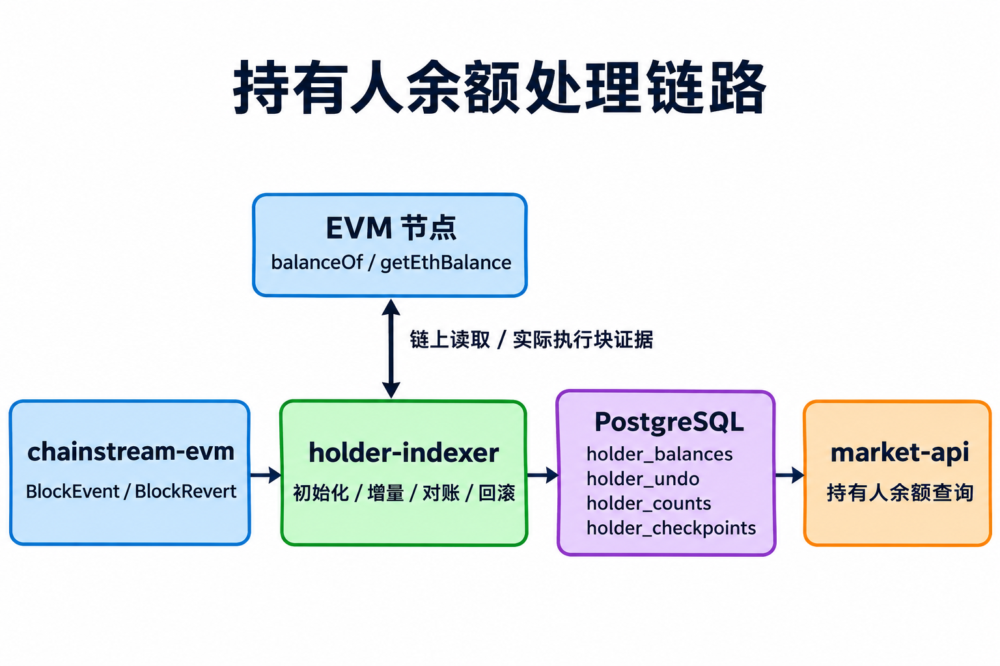
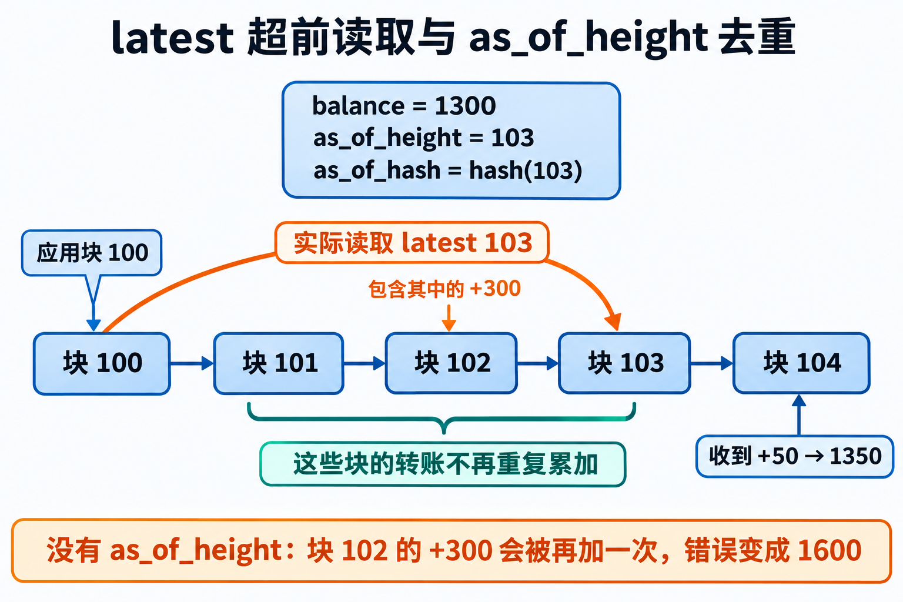
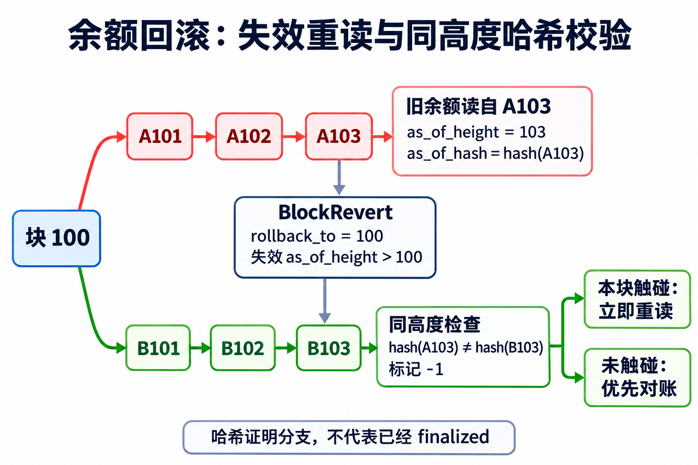

# holder-indexer：持有人余额与人数

`holder-indexer` 消费原始链 topic，维护每个 `(chain_id, token, holder)` 的 ERC-20 / TRC-20 当前余额和每个代币的正余额地址数；开启 `native_balances` 时也维护原生币。

| 项目 | 内容 |
| --- | --- |
| 启动入口 | `cmd/holder-indexer`；默认配置 `configs/holder-indexer.yaml` |
| 业务代码 | `internal/app/holder/biz/indexer.go` |
| 存储代码 | `internal/app/holder/data/holder.go` |
| 输入 | 链 topic 的 `transfers`、`native_touched`；EVM 节点的 `balanceOf` / `getEthBalance` |
| 输出 | PostgreSQL `holder_balances`、`holder_counts`、`holder_undo`、`holder_checkpoints` |
| 下游 | market-api 的持有人接口；market-rankings 的 `holders` 列 |

本页是组件导览和字段速查。各种失败分支、EIP-1898、TRON、同高度分叉校验和 SQL 执行顺序，见完整的[持有人余额专题](../holder-balances.md)。

## 1. 为什么不能只累加 Transfer

仅有转账日志不足以得到可靠余额：

- 服务可能从链中间启动，第一次见到的地址已有历史余额；
- rebase、收税、非标准合约可能让实际余额与 Transfer 金额不同；
- 原生币还受 gas、出块奖励、L2 费用、内部转账和提款影响；
- latest 读取可能包含当前应用块之后的转账，直接再累加会重复；
- 未 finalized 的读取和应用结果都可能被重组撤销。

因此它采用“**首次全量读取 + 后续净转账 + 周期对账 + 可撤销增量**”的混合模型，而不是全表扫描或纯事件累加。

## 2. 基本流程

### 2.1 普通 ERC-20 / TRC-20

1. 每块先按 `(token, holder)` 汇总所有非零 Transfer 的净额，自转账自然抵消，零地址不建行。
2. 当读取高度对应的真正区块到达时，用 `as_of_hash` 检查更早写入的 latest 余额是否来自同一分支；异分支先标为待重读。
3. 从 PostgreSQL 批量加载本块触及的已有持仓。
4. 新持仓调用 `balanceOf` 做 seed；已有且可信的持仓只加本块净额；失效持仓先重读再修正。
5. 到达对账周期时，追加读取最久未验证的一批持仓，把链上值与存储值的差作为修正 delta。
6. 在同一 PostgreSQL 事务里写当前余额、zero-crossing 人数变化、undo 和检查点。

### 2.2 原生币

原生币使用伪代币地址 `0xeeeeeeeeeeeeeeeeeeeeeeeeeeeeeeeeeeeeeeee`，但不按 native transfer 累加：

- 每块读取 `native_touched` 中全部地址的 `getEthBalance`；
- 实际值与旧值之差作为 verified delta；
- 新地址只在余额大于零时建行；
- 未覆盖的内部转账接收方和信标链提款依靠对账纠偏；从未入表且只收到提款的新地址不会被自动发现。

## 3. 核心流程详解

### 3.1 seed：首次读取已包含本块

首次见到某持仓时，`balanceOf` 返回的是块后全量状态，因此直接把它作为初值，不再加触发读取的那笔 Transfer。这既补齐启动前历史，也避免“读完全量后又加本块”的重复。

如果合约调用本身 revert，可以用本块净转账建立**未验证估算**；如果节点缺状态、超时或无法证明读取分支，则整个块不能提交。前者容忍坏代币，后者防止系统性错账。

### 3.2 `as_of_height`：让 latest 与增量共存

假设应用块 100 时从 latest 块 103 读到 Alice 余额 1300：

- 保存 `balance=1300, as_of_height=103, as_of_hash=hash(103)`；
- 应用 101、102、103 时，不再叠加这些块的 Alice 转账；
- 到块 104 才继续加新的净转账。

`verified_height` 与 `as_of_height` 因此不可合并：前者服务“多久没做验证处理”，后者服务“哪些转账已包含”。

### 3.3 对账：把修正也变成可撤销 delta

对账不是简单 `UPDATE balance = actual`，而是计算 `delta = actual - stored` 后走与普通转账相同的写入和 undo 通道。这样 rebase 修正、原生币刷新和普通 Transfer 都能用“减去 delta”统一回滚。

对账只处理有界批次，是最终纠偏，不是每块全量审计。关闭对账或关闭 native balances 后，相应的可见性边界也会变化，详见专题。

## 4. 表与字段

### 4.1 `holder_balances`：当前余额与读取坐标

主键：`(chain_id, token, holder)`。

| 字段 | 类型 | 含义 |
| --- | --- | --- |
| `chain_id` | `BIGINT` | 数字链 ID |
| `token` | `TEXT` | 代币合约地址，或原生币伪地址；EVM 小写，TRON base58 保留大小写 |
| `holder` | `TEXT` | 持有人地址；零地址不保存为持有人 |
| `balance` | `NUMERIC(78,0)` | 最小单位的整数余额，不是人类单位，不是浮点数；可能为已验证值或估算值 |
| `verified_height` | `BIGINT NULL` | 最近一次“验证处理被提交”的应用块高；新估算行和重组失效时为 `NULL`；失败的对账调用也可能推进它 |
| `as_of_height` | `BIGINT` | 余额已包含到哪个实际读取块；普通转账不推进它；`-1` 表示读取点不可信，须重读 |
| `as_of_hash` | `TEXT NULL` | `as_of_height` 对应块哈希；`-1` 失效时清空；历史迁移行可能为 `NULL` |

索引 `holder_balances_top` 服务 Top Holders，`holder_balances_verified` 服务最久未验证队列，`holder_balances_as_of` 服务同高度哈希检查。

### 4.2 `holder_undo`：每块每个持仓的可逆操作

主键：`(chain_id, block_height, token, holder)`。

| 字段 | 类型 | 含义 |
| --- | --- | --- |
| `chain_id` | `BIGINT` | 链 ID |
| `block_height` | `BIGINT` | 变化所属的流中应用块高，不一定是 latest 实际读取高度 |
| `token` / `holder` | `TEXT` | 被修改的持仓 |
| `delta` | `NUMERIC(78,0)` | 本块实际加到旧余额上的有符号量；回滚减去它；新建行通常为 0 |
| `created` | `BOOLEAN` | 是否由本块创建；回滚时直接删除整行 |
| `prev_verified` | `BIGINT NULL` | 本块修改前的 `verified_height` |
| `prev_as_of` | `BIGINT` | 本块修改前的 `as_of_height` |
| `prev_as_of_hash` | `TEXT NULL` | 本块修改前的 `as_of_hash`，必须与旧高度一起恢复 |

它不是每块完整余额快照。对账修正也写 delta，因此同样可回滚。

### 4.3 `holder_counts`：正余额人数

主键：`(chain_id, token)`。

| 字段 | 类型 | 含义 |
| --- | --- | --- |
| `chain_id` | `BIGINT` | 链 ID |
| `token` | `TEXT` | 代币或原生币伪地址 |
| `holders` | `BIGINT` | 当前 `balance > 0` 的持仓行数；余额跨越零时同步 ±1，回滚时反向恢复 |

零余额行可以留在 `holder_balances`，但不计入人数。首次引入此表时 DDL 会从旧余额表一次性回填；日常查询不做全表 `count(*)`。

### 4.4 `holder_checkpoints`：消费与撤销边界

主键：`chain_id`。

| 字段 | 类型 | 含义 |
| --- | --- | --- |
| `chain_id` | `BIGINT` | 链 ID |
| `kafka_offset` | `BIGINT` | 最后完整提交的流 offset；文件源时为记录序号 |
| `block_height` | `BIGINT` | 最后应用块高；注意 latest 的余额高水位可能高于它 |
| `block_hash` | `TEXT` | 最后应用块哈希；有效回滚后清空 |
| `pruned_through` | `BIGINT` | undo 已裁剪到的高度，只增不减；更深回滚会停止 |
| `updated_at` | `TIMESTAMPTZ` | 最后提交时间 |

### 4.5 相关联但不归它写的表

| 表 | 关系 |
| --- | --- |
| `token_rankings.holders` | rankings 周期复制 `holder_counts` 的读模型，不是实时事实源 |
| `raw_transfers` | ch-loader 的 ClickHouse 原始流水；holder-indexer 不通过反查它更新余额 |
| `wallet_positions.quantity` | market-wallet 的“有 DEX 成本持仓”，不等于链上实际余额 |
| `registry_tokens.decimals` | API 展示时把原始余额转成人类单位，余额计算本身不依赖它 |

## 5. 重组与重启

回滚到 `R` 的一个事务中：

1. 删除 `R` 之后新建的余额行，并修正人数；
2. 对已有行按持仓汇总并减去 `sum(delta)`；
3. 恢复范围内最早的 `prev_verified` / `prev_as_of` / `prev_as_of_hash`；
4. 删除已经使用的 undo；
5. 将剩余 `as_of_height > R` 的行标为 `-1`，因为它们可能读自已消失的分支；
6. 保存检查点与裁剪边界。

先删 created 行再减 delta 是有意的：同一持仓若在被回滚区间先创建后修改，整行都应消失，不应再接受后续 delta。

即使 `rollback_to >= checkpoint.block_height`，latest 也可能留有更高读取点，所以 `UnappliedReverter` 仍会执行失效，但不会伪造应用高度变化。

## 6. 设计巧思与明确边界

- **高水位 + 哈希**：同时解决“不要重复加未来转账”和“不要误用另一条分支的未来状态”。
- **修正统一为 delta**：避免为 Transfer、rebase、native 各写一套回滚算法。
- **人数跟随 zero crossing**：排行榜查询成本与持有人总数解耦。
- **重组时只失效、按需修复**：避免 revert 对热门代币全部 holder 发起不可控 RPC 峰值。
- **当前可见不等于已 finalized**：`as_of_height=-1` 的旧数值在重读前仍可能被 API 返回；接口也不返回该失效标志。
- **不是全局同块快照**：不同持仓可有不同 `as_of_height`；追块时余额和人数可能超前于消费检查点。
- **不保证发现从未活动的地址**：服务不枚举合约存储，也不会凭空发现只在数据流起点之前持有、之后不再转账的地址。

## 7. 关键配置与代码索引

| 配置 | 默认 | 说明 |
| --- | --- | --- |
| `chains[].state_reads` | `latest` | 普通 EVM 解析不早于当前块的链头并按哈希读；`exact` 按当前块哈希读，深历史需 archive |
| `holders.reconcile_every` | 100 | 每多少块对账；负数关闭 |
| `holders.reconcile_batch` | 200 | 每批最久未验证持仓数 |
| `holders.rpc_batch_size` | 100 | RPC 调度批量大小 |
| `holders.native_balances` | true（配置文件） | 是否维护原生币；无可用 multicall 的链会跳过 |
| `holders.history_depth` | 256 | 至少覆盖上游 `scanner.cache_size` |

| 关注点 | 路径 |
| --- | --- |
| 每块选择、seed、增量、对账 | `internal/app/holder/biz/indexer.go` |
| 余额 / 人数 / undo / 检查点事务 | `internal/app/holder/data/holder.go` |
| exact / latest / TRON 读取 | `internal/pkg/rpc/client.go`、`tron.go` |
| 完整设计与失败语义 | [../holder-balances.md](../holder-balances.md) |
