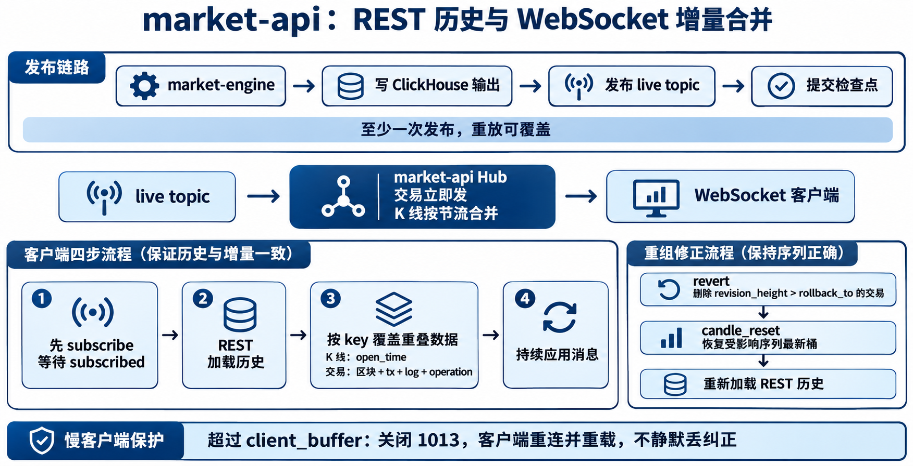
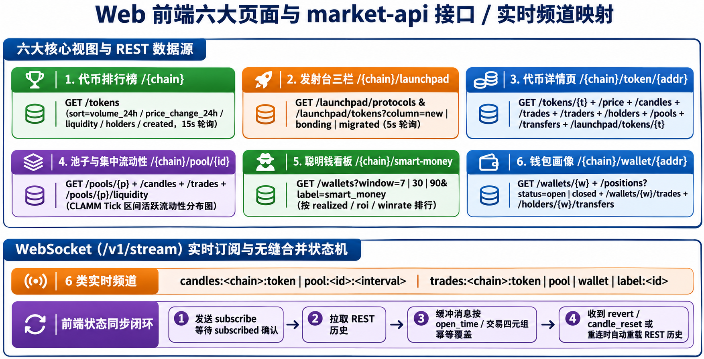

# market-api：统一查询与实时推送

`market-api` 是系统的只读聚合层：把其它组件写入 ClickHouse / PostgreSQL 的表转换为 REST 响应，并把 market-engine 的 live topic 扇出为 WebSocket 客户端订阅。它不在请求热路径调用链节点，也不重新运行定价、余额或账本算法。

| 项目 | 内容 |
| --- | --- |
| 启动入口 | `cmd/market-api`；默认配置 `configs/market-api.yaml` |
| HTTP 代码 | `internal/app/api/service` |
| 查询代码 | `internal/app/api/data` |
| 实时分发 | `internal/pkg/live` |
| 输入 | 两个数据库、live topic、钱包标签 |
| 业务写入 | 无；启动时会执行建库 / 建表 DDL，使空环境可按任意顺序启动 |
| 下游 | Web 前端和任意 REST / WebSocket 客户端 |

## 1. 基本请求流程

1. 解析 chain ID、地址、limit、时间窗口或翻页游标，并进行格式校验。
2. 对行情 token 地址做资产别名归一，例如原生币伪地址映射为包装代币。
3. 调用 `service` 层的 Reader 接口，由 `data` 层查询 ClickHouse 或 PostgreSQL。
4. 必要时做轻量联读与展示换算：registry decimals、rankings 现价、wallet labels、launchpad direct 伪进度。
5. 十进制金额以字符串序列化，避免 JSON 浮点精度损失；错误返回 JSON `error`。

`/healthz` 只表示进程存活，返回 204，不逐项检查所有上游数据是否新鲜。



## 2. 涉及哪些表，字段在哪里查

market-api 没有专属业务表。下表列出它读取的表、重点字段和该字段的字典位置；逐列类型与完整语义以对应生产者组件页为准，避免只读层复制出另一份不一致的定义。

### 2.1 market-engine 的行情与状态

| 表 | API 使用字段 | 用途 | 完整字段字典 |
| --- | --- | --- | --- |
| `trades` | 成交身份、`pool_id`、`base_token`、`side`、base/quote 数量、`price_usd`、`value_usd`、`outlier` | 池子 / 代币最近交易 | [market-engine](market-engine.md#33-clickhouse-trades) |
| `token_prices` | `token`、`block_height`、`price_usd`、`source`、`hops`、`liquidity_usd` | 最新价格与定价路径展示 | [market-engine](market-engine.md#34-clickhouse-token_prices) |
| `candles` | `subject`、`key`、`interval_seconds`、`open_time`、OHLCV、`trades`、`update_height` | 池子 / 代币历史 K 线 | [market-engine](market-engine.md#35-clickhouse-candles) |
| `engine_state`（`kind=ticks`） | `key=pool|tick`、`value=liquidityNet` | 集中流动性区间分布 | [engine_state](market-engine.md#37-postgresql-engine_state) |
| `engine_state`（`kind=clamm_pools`） | pool ID → 快照高度、sqrt price、stale、fee、hook 标记 | 当前价格、价格带和 `usable` 判定 | 同上 |

### 2.2 ch-loader 的原始事实

| 表 | API 使用字段 | 用途 | 完整字段字典 |
| --- | --- | --- | --- |
| `raw_transfers` | 块高 / 时间、tx hash、`log_index`、`token`、from/to、`amount` | 代币转账和地址跨代币转账 | [ch-loader](ch-loader.md#31-raw_transfers) |

API 不读取 `raw_trades` 来现场定价；回填由 engine 自己完成。`amount` 在响应中叫 `amount_raw`，仍为最小单位整数字符串。

### 2.3 holder-indexer 与 market-registry

| 表 | API 使用字段 | 用途 | 完整字段字典 |
| --- | --- | --- | --- |
| `holder_balances` | `token`、`holder`、`balance` | 正余额 Top Holders；不读取验证坐标来决定是否展示 | [holder-indexer](holder-indexer.md#41-holder_balances当前余额与读取坐标) |
| `holder_counts` | `token`、`holders` | O(1) 取得正余额人数 | [holder_counts](holder-indexer.md#43-holder_counts正余额人数) |
| `registry_tokens` | 标准、识别、name/symbol/decimals、metadata、created/deployment、source 与更新高度 | 代币详情、持仓金额换算、列表元数据、symbol 搜索 | [market-registry](market-registry.md#31-registry_tokens) |
| `registry_pools` | `pool_id`、protocol、dex、tokens、created、source、metadata | 池详情与某代币的池列表 | [registry_pools](market-registry.md#32-registry_pools) |

持有人接口的 `balance_raw` 是数据库整数；registry 已知 decimals 时附带换算后的 `balance`。原生币伪地址按 18 位展示。该接口不返回 `as_of_height` / `as_of_hash`，也不隐藏 `as_of_height=-1` 的待重读值。

### 2.4 market-rankings 与 market-launchpad

| 表 | API 使用字段 | 用途 | 完整字段字典 |
| --- | --- | --- | --- |
| `token_rankings` | 价格、价格高度、流动性、24h 量 / 笔数 / 涨跌幅、holders、created | 代币列表；也提供持仓现价和 launchpad 行情补充 | [market-rankings](market-rankings.md#31-token_rankings) |
| `ranking_checkpoints` | `refreshed_at` | 告诉调用方榜单最近一次成功刷新时间 | [ranking_checkpoints](market-rankings.md#32-ranking_checkpoints) |
| `launchpad_tokens` | 发射身份、状态、曲线原始值、交易计数、生命周期时间、direct 字段 | 三栏列表与单币曲线详情 | [market-launchpad](market-launchpad.md#41-launchpad_tokens) |
| `launchpad_heads` | `block_time` | 列表窗口的链上“now” | [launchpad_heads](market-launchpad.md#42-launchpad_heads) |
| `launchpad_protocols` | `protocol` | 平台筛选选项 | [launchpad_protocols](market-launchpad.md#43-launchpad_protocols) |

direct launch 的伪进度由 API 查询时根据 launch window 或 rankings FDV 计算；数据库 `launchpad_tokens.progress` 不一定是最终展示值。

### 2.5 market-wallet

| 表 | API 使用字段 | 用途 | 完整字段字典 |
| --- | --- | --- | --- |
| `wallet_positions` | 数量、成本、realized、累计买卖、计数、首次 / 当前轮 / 最近时间 | 钱包持仓、未实现盈亏、代币盈利榜 | [market-wallet](market-wallet.md#51-wallet_positions) |
| `wallet_labels` | `wallet`、`label`、`source`、`since` | 钱包标签、排行榜过滤、交易 / 持有人标签和 label 频道 | [wallet_labels](market-wallet.md#55-wallet_labels) |
| `wallet_trades` | 成交坐标、event、金额、realized、cost、counted、hold time、交易后状态 | 钱包账本流水与游标翻页 | [wallet_trades](market-wallet.md#61-wallet_trades) |
| `wallet_stats` | 窗口统计、收益桶、version | 钱包画像和聪明钱排行 | [wallet_stats](market-wallet.md#63-wallet_stats) |
| `wallet_refreshes` | 最新 `version` | 保证统计只读同一代 | [wallet_refreshes](market-wallet.md#64-wallet_refreshes) |

`wallet_undo`、两个 checkpoint / invalidation 表是写入与恢复内部状态，API 不直接读取。

## 3. REST 接口

| 接口 | 返回与主要参数 |
| --- | --- |
| `GET /v1/chains/{chain}/tokens/{token}/price` | 最新 USD 价、source、hops、liquidity 与价格坐标 |
| `GET /v1/chains/{chain}/tokens/{token}/candles?interval=1m` | 代币聚合 K 线 |
| `GET /v1/chains/{chain}/pools/{pool}/candles?interval=1m` | 单池 K 线 |
| `GET /v1/chains/{chain}/tokens/{token}/trades` | base 为该代币的最近交易 |
| `GET /v1/chains/{chain}/pools/{pool}/trades` | 池子最近交易 |
| `GET /v1/chains/{chain}/tokens/{token}/holders` | holder count 与最大正余额地址，附可选 labels |
| `GET /v1/chains/{chain}/tokens/{token}` | 代币 registry 元数据 |
| `GET /v1/chains/{chain}/tokens/{token}/pools` | 包含该代币的池，最近观察到优先 |
| `GET /v1/chains/{chain}/pools/{pool}` | 池 registry 元数据 |
| `GET /v1/chains/{chain}/pools/{pool}/liquidity` | 当前价附近的 tick 区间币量、合计、价格带深度和 `usable`；无表返回 404 |
| `GET /v1/chains/{chain}/tokens` | 排行榜及 registry 搜索，见 rankings 文档 |
| `GET /v1/chains/{chain}/launchpad/protocols` | 已有发射平台 |
| `GET /v1/chains/{chain}/launchpad/tokens?column=new` | new / bonding / migrated 列表 |
| `GET /v1/chains/{chain}/launchpad/tokens/{token}` | 单币生命周期与曲线；未见过返回 404 |
| `GET /v1/chains/{chain}/tokens/{token}/transfers` | 代币 ERC-20 转账；`holder` 限定一方 |
| `GET /v1/chains/{chain}/holders/{holder}/transfers` | 地址跨代币转入转出；`token` 限定代币 |
| `GET /v1/chains/{chain}/wallets/{wallet}` | 钱包标签及各窗口统计 |
| `GET /v1/chains/{chain}/wallets/{wallet}/positions` | 当前 / 已清仓持仓；`status=open|closed` |
| `GET /v1/chains/{chain}/wallets/{wallet}/trades` | 钱包账本流水；支持 `token` 和完整游标 |
| `GET /v1/chains/{chain}/wallets?window=30&label=smart_money` | 钱包排行；`sort=realized|winrate|roi|volume` |
| `GET /v1/chains/{chain}/tokens/{token}/traders` | 该代币钱包按累计 realized PnL 排序 |
| `GET /v1/stream` | WebSocket；仅在 `live.enabled=true` 注册 |
| `GET /healthz` | 204 存活响应 |

### 3.1 通用约定

- `{chain}` 是正整数链 ID；非法参数返回 400，资源不存在按对应路由返回 404，内部错误返回 500。
- 地址通常转小写；**价格 / K 线 / 交易**的 token 会映射原生币别名，holders / registry / transfers 按各自事实语义处理，不能全局假设所有地址都映射。
- 普通 `limit` 默认 200、最大 1000；launchpad 列表默认 50、最大 1000。
- K 线 `from <= open_time < to`，`from < to`，`interval` 必须同时被 API 配置且由 engine 实际生成。
- 历史 K 线只返回有成交桶，响应按时间从旧到新；每个桶先取最大 `update_height` 的完整版本。
- 普通 trades 用 `before_height` 向更早块翻页。
- 转账整页返回 `next={before_height,before_log_index}`；钱包流水还包含 `before_operation_index`，避免同一块 / 同一日志的分页遗漏。
- 小数值和原始大整数都用字符串，调用方不要用二进制浮点做财务计算。

### 3.2 典型接口响应与跨块游标翻页示例

#### 1. 代币最新价格与定价路径（`GET /v1/chains/1/tokens/0xc02aaa39b223fe8d0a0e5c4f27ead9083c756cc2/price`）

```json
{
  "chain_id": 1,
  "token": "0xc02aaa39b223fe8d0a0e5c4f27ead9083c756cc2",
  "block_height": 20000100,
  "block_time": 1730000000,
  "price_usd": "2512.34567890123456789",
  "source": "graph",
  "hops": 1,
  "liquidity_usd": "48523100.12"
}
```

#### 2. 集中流动性池 Tick 区间分布与价格带深度（`GET /v1/chains/1/pools/{pool}/liquidity?band_bps=100`）

```json
{
  "chain_id": 1,
  "pool_id": "0x88e6a0c2ddd26feeb64f039a2c41296fcb3f5640",
  "protocol": "uniswap_v3",
  "tokens": [
    "0xa0b86991c6218b36c1d19d4a2e9eb0ce3606eb48",
    "0xc02aaa39b223fe8d0a0e5c4f27ead9083c756cc2"
  ],
  "decimals": [6, 18],
  "usable": true,
  "current_tick": 198012,
  "sqrt_price_x96": "1583920192837465102938475",
  "band_bps": 100,
  "totals": [
    {"raw": "28450120000000", "value": "28450120"},
    {"raw": "11320000000000000000000", "value": "11320"}
  ],
  "depth": [
    {"raw": "1420000000000", "value": "1420000"},
    {"raw": "565000000000000000000", "value": "565"}
  ],
  "ranges": [
    {
      "tick_lower": 197900,
      "tick_upper": 198100,
      "liquidity": "94827162534123987123",
      "amounts": [
        {"raw": "412000000000", "value": "412000"},
        {"raw": "164000000000000000000", "value": "164"}
      ]
    }
  ]
}
```

#### 3. 钱包账本流水与三元游标无损翻页（`GET /v1/chains/1/wallets/{wallet}/trades?limit=2`）

由于同一区块、甚至同一条合约日志（如聚合批量路由）可能拆出多笔池操作，仅靠 `before_height` 翻页会漏掉同块剩余记录。当返回条数等于 `limit` 时，响应会附带 `next` 三元游标：

```json
{
  "trades": [
    {
      "block_height": 20000105,
      "block_time": 1730000060,
      "transaction_hash": "0xabc...",
      "log_index": 42,
      "operation_index": 1,
      "token": "0x6982508145454ce325ddbe47a25d4ec3d2311933",
      "side": "sell",
      "event": "reduce",
      "amount": "500000000",
      "value_usd": "5200.00",
      "price_usd": "0.0000104",
      "realized_usd": "1450.00",
      "cost_sold_usd": "3750.00",
      "counted": true,
      "hold_seconds": 0,
      "quantity_after": "1500000000",
      "cost_after": "11250.00"
    },
    {
      "block_height": 20000105,
      "block_time": 1730000060,
      "transaction_hash": "0xabc...",
      "log_index": 42,
      "operation_index": 0,
      "token": "0x6982508145454ce325ddbe47a25d4ec3d2311933",
      "side": "buy",
      "event": "add",
      "amount": "1000000000",
      "value_usd": "10000.00",
      "price_usd": "0.0000100",
      "realized_usd": "0",
      "cost_sold_usd": "0",
      "counted": false,
      "hold_seconds": 0,
      "quantity_after": "2000000000",
      "cost_after": "15000.00"
    }
  ],
  "next": {
    "before_height": 20000105,
    "before_log_index": 42,
    "before_operation_index": 0
  }
}
```

下一页请求只需把 `next` 的三个字段原样拼入 Query 参数：
`GET /v1/chains/1/wallets/{wallet}/trades?limit=2&before_height=20000105&before_log_index=42&before_operation_index=0`。

### 3.3 Web 前端六大视图与 API / WebSocket 映射



## 4. WebSocket 实时推送

### 4.1 发布与扇出流程

engine 的顺序是“写输出 → 发布 live → 提交 checkpoint”，所以发布是至少一次。market-api 的 hub：

- 从每个 live topic 的末尾跟随，不使用消费组，每个 API 实例独立服务自己的客户端；
- trades 立即发送；candles 和 head 按 `live.candle_throttle` 合并，每桶只发最新完整值；
- 标签频道通过每分钟重读的 wallet label 缓存过滤；
- 客户端落后超过 `live.client_buffer` 条消息时用 1013 断开，不能静默丢掉重组纠正。

Kafka 使用 `{topic}-live` 分区 0；Redis 使用同名 Pub/Sub channel。两者对 WebSocket 客户端采用相同消息协议，但 Redis Pub/Sub 本身不提供历史保留。

### 4.2 订阅协议

```json
{"op":"subscribe","channels":["candles:1:token:0xc02a...:1m","trades:1:pool:0x88e6..."]}
{"op":"unsubscribe","channels":["trades:1:pool:0x88e6..."]}
```

| 频道 | 内容 |
| --- | --- |
| `trades:<chain>:pool:<pool>` | 单池交易 |
| `trades:<chain>:token:<token>` | 以该代币为 base 的交易 |
| `candles:<chain>:pool:<pool>:<interval>` | 单池 K 线 |
| `candles:<chain>:token:<token>:<interval>` | 代币聚合 K 线 |
| `trades:<chain>:wallet:<wallet>` | 指定 trader 的交易 |
| `trades:<chain>:label:<label>` | 带指定标签的钱包交易，如 smart money |

服务端会小写地址、归一代币别名，并在 `subscribed` 中返回规范频道名。每连接最多 `live.max_subscriptions` 个频道；非法请求返回 `error`，不改变已有订阅。

### 4.3 消息语义

| 消息类型 | 含义与客户端动作 |
| --- | --- |
| `trades` | 新增 / 重发交易；每笔另带 `revision_height`，按成交身份覆盖 |
| `candle` | 某逻辑桶的完整当前值；按 `open_time` 替换，不做增量加减 |
| `head` | 最新推送高度和 finalized 高度 |
| `revert` | 删除该链所有 `revision_height > rollback_to` 的实时交易 |
| `candle_reset` | 每个受影响 K 线序列一条；恢复 rollback 时最新桶并删更新桶，`null` 表示当时无桶 |

发送 revert 前，hub 会先 flush 已节流的 candle / head，保证 reset 是受影响序列最后的纠正消息。

### 4.4 历史与增量无缝合并

推荐顺序不是“先 REST 后订阅”，而是：

1. WebSocket 先 subscribe，并等 `subscribed`；
2. 再通过 REST 加载历史；
3. 最后应用订阅期间缓存的消息；
4. K 线按 `(subject,key,interval,open_time)` 覆盖，交易按 `(chain,block_height,transaction_hash,log_index,operation_index)` 覆盖；
5. 重连、收到 revert / reset 后按前端策略重新加载历史，避免本地状态残留。

因为 REST trades 响应不带 revision height，发生重组后仅删本地实时交易不足以证明历史页干净，所以重新拉取历史是简单可靠的做法。

## 5. 设计巧思与一致性边界

- **Reader 接口隔离 HTTP 与存储**：路由处理不负责拼所有 SQL，表归属仍由生产组件定义。
- **读模型各司其职**：榜单读 rankings、人数读 holder_counts、统计读 versioned stats，API 不在请求中扫描原始全集。
- **标签短缓存**：交易、持有人和实时 label 频道共享内存标签，每分钟刷新；新标签最多存在这个额外延迟。
- **完整值覆盖而非差分推送**：重复发布、迟到交易和 K 线纠正都能用幂等覆盖消化。
- **背压时断开而不是跳消息**：对重组流而言，悄悄丢弃一条 reset 比暂时断连更危险。
- **数据库是共享读模型，不是分布式事务**：不同组件各自有进度，一次 HTTP 响应中的价格、人数、标签可能对应不同刷新时刻。
- **启动建表不等于写入数据**：API 可在空库启动，但此时路由返回空数据或 404，并不代表生产者已健康运行。
- **无内置业务鉴权**：WebSocket 流没有鉴权；跨源浏览器连接必须匹配 `live.allowed_origins`。生产暴露时应由网关承担认证、限流和访问控制。

## 6. 配置与代码索引

| 配置 | 默认 | 说明 |
| --- | --- | --- |
| `api.addr` | `:8080` | HTTP 监听地址 |
| `api.intervals` | 1m～24h | 必须是 engine `market.intervals` 子集 |
| `api.launchpad.*` | 69k / 按协议覆盖 | direct 无窗口时的 FDV 伪进度目标 |
| `live.enabled` | false | 是否注册 `/v1/stream` 并启动 hub |
| `live.driver` | kafka | 必须与 engine 发布端一致；Redis 用 Pub/Sub |
| `live.candle_throttle` | 250ms | K 线 / head 合并发送间隔 |
| `live.client_buffer` | 1024 | 慢客户端消息缓冲上限 |
| `live.max_subscriptions` | 200 | 单连接频道上限 |
| `live.allowed_origins` | `[]` | 允许跨源浏览器 origin pattern |

| 关注点 | 路径 |
| --- | --- |
| 路由、通用参数与基础响应 | `internal/app/api/service/api.go` |
| 各业务接口 | `internal/app/api/service/{rankings,launchpad,wallets,holders,...}.go` |
| 数据库查询 | `internal/app/api/data` |
| 标签缓存 | `internal/app/api/data/wallets.go` |
| 实时消息与 hub | `internal/pkg/live/message.go`、`hub.go`、`websocket.go` |
| 启动建表与 hub 装配 | `internal/app/api/data/data.go` |
