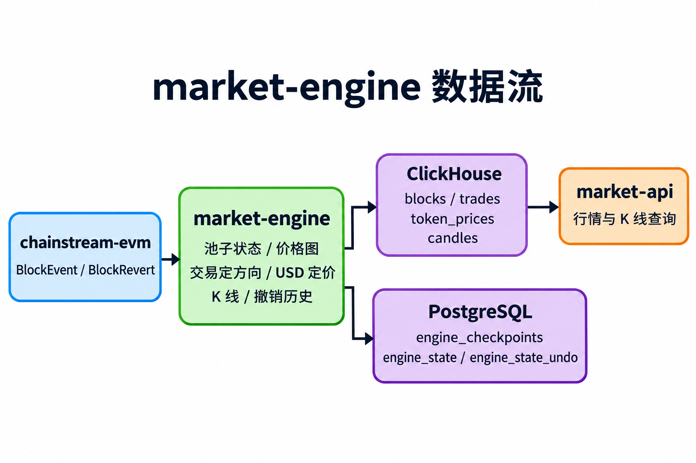
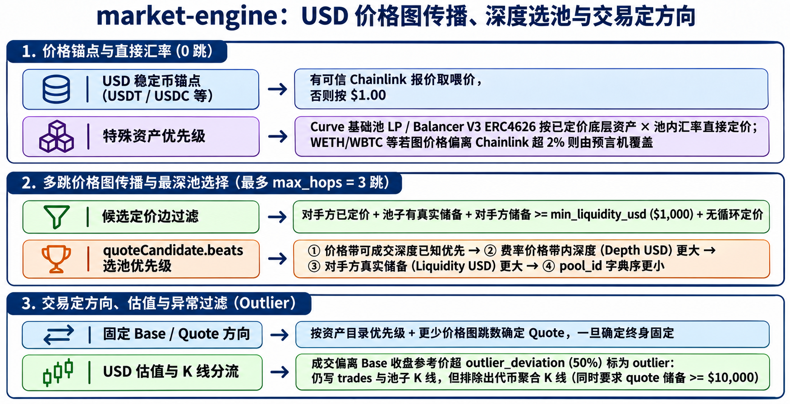
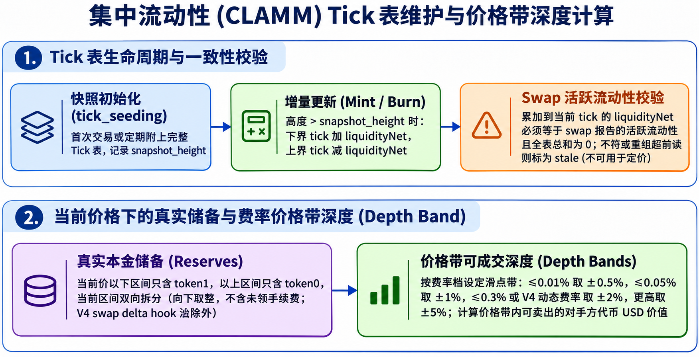
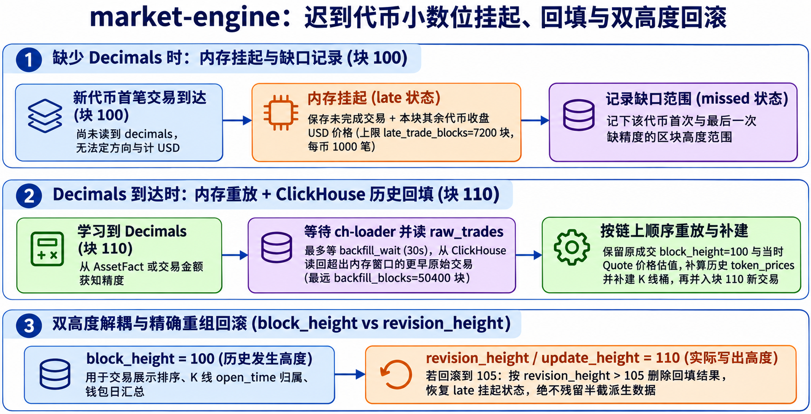

# market-engine：行情派生核心

`market-engine` 把 chainstream-evm 的原始区块事实转换成可直接查询的行情：带 base/quote 方向和 USD 价值的交易、代币 USD 价格、池子与代币 K 线，以及可选的实时消息。

| 项目 | 内容 |
| --- | --- |
| 启动入口 | `cmd/market-engine`；默认配置 `configs/market-engine.yaml` |
| 业务代码 | `internal/app/engine/biz` |
| 存储代码 | `internal/app/engine/data` |
| 输入 | 每条链的原始 topic；Chainlink 代理所需的 RPC；回填时读取 ch-loader 的 `raw_trades` |
| 输出 | ClickHouse `blocks` / `trades` / `token_prices` / `candles`；live topic |
| 可选状态 | PostgreSQL `engine_checkpoints` / `engine_state` / `engine_state_undo` |
| 下游 | market-api、market-rankings、market-wallet |

更完整的算法推导见 [market-engine 深度专题](../market-engine.md)。本页侧重组件级流程和字段字典。

## 1. 基本流程

每条链有独立的消费循环和 `Processor`，同一链内严格串行：

1. `chainsync` 从检查点的下一 offset 读取记录，校验链 ID、块高连续性和 parent hash。
2. 对 `BlockEvent`，`Processor.Apply` 在内存中更新池状态、计算价格图、定方向并生成 K 线。
3. ClickHouse 输出存储先删除可能存在的同高度旧输出，再依次写交易、价格、K 线，最后写 `blocks`。
4. 开启 live 时，在输出写成功后发布该块交易和改动的 K 线；过旧的追块数据可不发布。
5. `Commit` 保存检查点；`state.driver: postgres` 时，状态增量、undo 和检查点在同一 PostgreSQL 事务中提交。
6. 对 `BlockRevert`，先从撤销日志计算受影响的 K 线序列，再恢复内存状态、删除 ClickHouse 中回滚点之后的输出、发送实时纠正，最后提交新检查点。

这里有一个重要的顺序保证：

> **输出与实时通知发生在检查点之前。** 崩溃可能重复输出和重复通知，但不会把某块标成已完成却漏掉它的输出。输出重写和客户端覆盖负责消化这种“至少一次”。

## 2. 核心计算流程

### 2.1 池状态

| 池类型 | 价格来源 | 储备 / 深度来源 |
| --- | --- | --- |
| 常数乘积池 | `reserves_after` 的比例 | 交易后的储备 |
| V3 / V4 / Infinity 集中流动性池 | `sqrt_price_x96` | tick 表在当前价格下的实际币量与价格带深度 |
| Curve / Balancer | 块内余额快照及对应曲线数学 | 真实余额、StableSwap / Weighted / quote ladder |
| 发射平台 bonding curve | `pool_state.curve` | 已募集 quote 与曲线价格；使用独立低流动性门槛 |
| 其它池 | 最近 swap 成交价 | 无可靠储备时不参与价格传播 |

没有可用储备的池可以产生自己的成交价格，但不能成为传播 USD 价格的可靠边。集中流动性池的 tick 表一旦与 active liquidity 对不上，会被标为 stale，等下一份快照恢复，而不是继续使用可疑储备。

### 2.2 USD 价格图

1. USD 稳定币作为锚点；有可信 Chainlink 答案时使用答案，否则按 $1。
2. Curve 基础池 LP、Balancer V3 ERC4626 等按已定价底层资产和汇率优先定价。
3. 其它代币从已定价对手方沿池子传播，最多 `max_hops` 跳。
4. 候选边优先比较价格带内可成交深度，再比较对手方余额；对手方储备 USD 价值须达到 `min_liquidity_usd`。
5. 记录价格来源和路径，禁止通过“本身又由该代币定价”的对手方形成循环。

集中流动性池（CLAMM）的 Tick 表维护与价格带深度计算如下：

### 2.3 定方向、估值与 K 线

- quote 先由资产目录的优先级决定，再参考价格图跳数；一旦确定就固定，避免历史成交在 base/quote 间来回翻转。
- `price_quote = quote_amount / base_amount`，再用本块 quote 的 USD 价换算 `price_usd` 和 `value_usd`。
- 只有已定价 swap 进入 K 线；池子自己的 K 线总会接收它，代币聚合 K 线还要求 quote 流动性达标且不是 outlier。
- **OHLC 使用 USD 价格**，不是原始 quote 价格；`volume_base` 是 base 人类单位数量，`volume_usd` 是成交额。
- 新桶从前一桶 close 开盘，因此空档不会被画成无依据的跳变；空桶本身不写库。

### 2.4 迟到精度与回填

新代币的前几笔交易可能还没有 decimals。engine 不丢弃它们，而是：

1. 将缺精度的交易和必要的当时价格挂起，并限制每币数量与保留块数。
2. decimals 到达后，保留原成交块高和时间，按当时 quote 价格重放。
3. 从 ch-loader 的 `raw_trades` 补充已经超过内存挂起窗口的历史交易。
4. 补写历史交易、历史价格和旧 K 线桶，但用当前“写出块”作为 revision / update 高度。

这条机制让“事情发生在哪块”和“系统在哪块才足以算出它”成为两个独立维度。

## 3. 涉及哪些表

### 3.1 表级分工

| 表 | 引擎 | 读写角色 | 一行 / 一行的意义 |
| --- | --- | --- | --- |
| `blocks` | ClickHouse | 写；rankings / wallet 读 | 一个完整写出的区块；最后插入，充当完成标记 |
| `trades` | ClickHouse | 写；api / wallet 读 | 一笔已定方向的池子操作 |
| `token_prices` | ClickHouse | 写；api / rankings 读 | 某代币在某块得到的一个 USD 价格 |
| `candles` | ClickHouse | 写；api / rankings 读 | 某 K 线桶在某次更新后的完整版本 |
| `engine_checkpoints` | PostgreSQL | `state.driver: postgres` 时读写 | 每条链一个消费检查点 |
| `engine_state` | PostgreSQL | 同上 | 一个 `(kind, key)` 的当前 JSON 状态 |
| `engine_state_undo` | PostgreSQL | 同上 | 某块第一次修改某状态键之前的 JSON 值 |

`storage.driver: memory` 时四张 ClickHouse 输出表不写；`state.driver: memory` 时三张 PostgreSQL 状态表不写。API 只有在配置了相应数据库时才能读到这些数据。

### 3.2 ClickHouse `blocks`

| 字段 | 类型 | 含义 |
| --- | --- | --- |
| `chain_id` | `UInt64` | 数字链 ID；排序键第一部分 |
| `block_height` | `Int64` | 完整输出的区块高度；回滚按它删除 |
| `block_hash` | `String` | 该输出的区块哈希 |
| `block_time` | `DateTime('UTC')` | 区块时间；rankings 用它确定链上“现在” |
| `finalized` | `Bool` | 发布时该块是否不高于上游给出的 finalized 高度 |

### 3.3 ClickHouse `trades`

| 字段 | 类型 | 含义 |
| --- | --- | --- |
| `chain_id` | `UInt64` | 链 ID |
| `block_height` | `Int64` | **成交实际发生**的区块；迟到重放时不改 |
| `block_time` | `DateTime('UTC')` | 成交所在块时间；用于月分区 |
| `transaction_hash` | `String` | 成交交易哈希 |
| `transaction_index` | `Int64` | 交易在区块内的位置 |
| `log_index` | `UInt32` | 触发操作的日志序号 |
| `operation_index` | `UInt32` | 同一日志拆出多个池操作时的序号 |
| `protocol` | `LowCardinality(String)` | 上游识别出的协议名 |
| `pool_id` | `String` | 池 ID；可能是协议特定的作用域 ID，不一定是合约地址 |
| `trader` | `String` | 交易发起方地址；market-wallet 用它作为账本钱包 |
| `side` | `Enum8` | 从 base 角度看的 `buy` / `sell`，或 `liquidity_added` / `liquidity_removed` |
| `base_token` | `String` | 被定价和统计的 base 代币 |
| `quote_token` | `String` | 计价代币 |
| `base_amount` | `Decimal256(36)` | base 成交数量，绝对值、人类单位 |
| `quote_amount` | `Decimal256(36)` | quote 成交数量，绝对值、人类单位 |
| `price_quote` | `Decimal256(36)` | 每单位 base 的 quote 价格 |
| `price_usd` | `Decimal256(36)` | 每单位 base 的 USD 价格；无 USD 路径时为零 |
| `value_usd` | `Decimal256(36)` | `quote_amount × quote USD 价`；无价格时为零 |
| `finalized` | `Bool` | 该次输出所属区块的 finalized 标记 |
| `revision_height` | `Int64` | **实际写出此行的区块**；普通成交等于 `block_height`，迟到成交更晚；回滚按它删除 |
| `outlier` | `Bool` | 是否偏离 base 参考价而被排除出代币聚合 K 线；不影响池子 K 线和原始查询 |

交易的自然去重键使用 `(block_height, transaction_hash, log_index, operation_index)`；实时合并时也应带链 ID。`revision_height` 用于撤销和补缺，不替代成交身份。

### 3.4 ClickHouse `token_prices`

| 字段 | 类型 | 含义 |
| --- | --- | --- |
| `chain_id` | `UInt64` | 链 ID |
| `token` | `String` | 被定价代币地址；原生币别名通常归一到包装代币 |
| `block_height` | `Int64` | 这个价格对应的链上高度 |
| `block_time` | `DateTime('UTC')` | 对应块时间；用于月分区和 rankings 增量扫描 |
| `price_usd` | `Decimal256(36)` | 一单位代币的 USD 价格 |
| `source` | `Enum8` | `anchor`（锚点 / 预言机参考）或 `graph`（池图传播） |
| `hops` | `UInt8` | 距最近锚点的图跳数；锚点为 0 |
| `liquidity_usd` | `Decimal256(36)` | 定价所用池中对手方真实储备的 USD 价值，不是池子双边 TVL |
| `revision_height` | `Int64` | 实际写出该价格的区块；迟到补价时大于 `block_height` |

“最新价”按 `block_height` 取每个 token 的最新版本，不是简单取最大 `revision_height`。

### 3.5 ClickHouse `candles`

| 字段 | 类型 | 含义 |
| --- | --- | --- |
| `chain_id` | `UInt64` | 链 ID |
| `subject` | `Enum8` | `pool`：单池；`token`：跨合格池聚合的代币 |
| `key` | `String` | `subject=pool` 时为 pool ID；`token` 时为代币地址 |
| `interval_seconds` | `UInt32` | K 线周期秒数；同时是分区键之一 |
| `open_time` | `DateTime('UTC')` | 桶起点，UTC；桶身份的一部分 |
| `open` / `high` / `low` / `close` | `Decimal256(36)` | 该桶内 base 的 USD OHLC |
| `volume_base` | `Decimal256(36)` | 桶内 base 成交数量之和 |
| `volume_usd` | `Decimal256(36)` | 桶内 USD 成交额之和 |
| `trades` | `UInt32` | 纳入该桶的 swap 笔数 |
| `update_height` | `Int64` | 生成这个完整桶版本的写出高度；回滚按它删除 |

一个逻辑桶由 `(chain_id, subject, key, interval_seconds, open_time)` 标识，可以有多行历史版本。查询必须先按最大 `update_height` 选当前版本，不能直接把多版本 OHLCV 再累加一次。

### 3.6 PostgreSQL `engine_checkpoints`

| 字段 | 类型 | 含义 |
| --- | --- | --- |
| `chain_id` | `BIGINT` | 链 ID，主键 |
| `kafka_offset` | `BIGINT` | 最后提交的链 topic offset；文件源时为记录序号 |
| `block_height` | `BIGINT` | 最后应用高度 |
| `block_hash` | `TEXT` | 最后应用块哈希，用于下一块 parent 校验；有效回滚后清空 |
| `pruned_through` | `BIGINT` | undo 已裁剪到的高度，只增不减 |
| `updated_at` | `TIMESTAMPTZ` | 最后提交时间 |

### 3.7 PostgreSQL `engine_state`

| 字段 | 类型 | 含义 |
| --- | --- | --- |
| `chain_id` | `BIGINT` | 链 ID |
| `kind` | `TEXT` | 状态类别，见下表 |
| `key` | `TEXT` | 类别内的业务键 |
| `value` | `JSONB` | 当前完整状态值；运行时解码成对应内存结构 |

| `kind` | `key` / `value` 含义 |
| --- | --- |
| `decimals` | 代币地址 → 已学习到的精度信息 |
| `pools` | pool ID → 普通池的最新价格、储备和方向相关状态 |
| `prices` | 代币 → 当前图价格及路径信息 |
| `orientations` | 交易对 → 固定的 base / quote 方向 |
| `candles` | `subject|interval_seconds|key` → 当前未完结序列状态 |
| `oracle` | 受配置信任的 feed / token 对应最新预言机状态 |
| `late` | 缺精度交易的挂起状态 |
| `missed` | 代币 → 曾缺精度的块高范围，用于 raw trades 回填 |
| `ticks` | `pool_id|tick` → 该 initialized tick 的 `liquidityNet` JSON 字符串 |
| `clamm_pools` | pool ID → tick 表快照高度、当前价、stale、动态费率与 hook 标记 |
| `balance_pools` | pool ID → Curve / Balancer 真实余额、曲线参数、汇率与报价阶梯 |

`engine_state` 是可重建的内部状态，不是对外公开 API 的稳定 JSON schema。market-api 的流动性接口只读取其中 `ticks` 与 `clamm_pools`。

### 3.8 PostgreSQL `engine_state_undo`

| 字段 | 类型 | 含义 |
| --- | --- | --- |
| `chain_id` | `BIGINT` | 链 ID |
| `block_height` | `BIGINT` | 修改发生的应用高度 |
| `kind` | `TEXT` | 被修改状态的类别 |
| `key` | `TEXT` | 被修改状态的业务键 |
| `prev` | `JSONB NULL` | 该块**第一次**修改前的值；`NULL` 表示此前不存在，回滚时删除当前键 |

同一 `(chain_id, block_height, kind, key)` 只保留第一次旧值；块内多次写入不会把 undo 改成中间态。

## 4. 实现中的巧思

- **两个高度解决迟到数据**：`block_height` 保留历史位置，`revision_height` 决定撤销归属；否则回填数据既可能回滚不干净，也可能被写到错误的桶版本。
- **K 线保存整桶版本**：回滚只删新版本，旧版本自然重新成为当前值，无需为 OHLCV 的每个字段写反向差分。
- **状态热路径不进数据库**：计算在内存完成，PostgreSQL 每块只持久化 dirty 增量；启动时在一致性快照里恢复。
- **按深度而非仅按储备选定价池**：储备大但价格稍动就耗尽的池，不应自动成为最可信的价格来源。
- **pool 与 token 两类 K 线分离**：异常池的真实异动仍可观察，但不会污染整个代币的聚合行情和榜单成交量。
- **迁移曲线使用迁移前流动性**：同一迁移块内的曲线交易按交易实际看到的曲线状态判断，而不是被块末迁移状态误伤。

## 5. 重组、重启与一致性

回滚到 `R` 时，各表使用的删除列不同：

| 表 | 删除条件 |
| --- | --- |
| `blocks` | `block_height > R` |
| `trades` | `revision_height > R` |
| `token_prices` | `revision_height > R` |
| `candles` | `update_height > R` |
| `engine_state` | 用内存 journal 恢复后 upsert / delete 对应键 |
| `engine_state_undo` | 删除 `block_height > R` 的已消费 undo |

undo 裁剪边界为 `max(finalized_height, height - history_depth)`。回滚低于已裁剪边界会停止，不能靠猜测继续。`history_depth` 至少应覆盖上游 `scanner.cache_size`。

`state.driver: memory` 的代价是重启从流开头重放；`postgres` 可以直接续传，但需要为状态表付出每块一次事务写入。两者都不改变派生算法。

## 6. 关键配置与边界

| 配置 | 默认 | 作用 / 注意事项 |
| --- | --- | --- |
| `market.min_liquidity_usd` | 1000 | 价格传播的最低对手方储备价值 |
| `market.candle_min_liquidity_usd` | 10000 | 进入代币聚合 K 线的 quote 储备门槛 |
| `market.curve_min_liquidity_usd` | 0 | 曲线池替代上述两个门槛，便于新币起价 |
| `market.max_hops` | 3 | 价格图最大跳数 |
| `market.intervals` | 1m～24h | API 与 rankings 只能选择这里实际生成的周期 |
| `market.history_depth` | 256 | 可撤销历史深度 |
| `market.outlier_deviation` | 0.5 | 相对偏差阈值；`-1` 关闭 |
| `market.late_trade_blocks` | 7200 | 内存挂起窗口；`-1` 丢弃缺精度交易 |
| `market.backfill_blocks` | 50400 | 从 raw trades 回填的最大范围；`-1` 仅重放挂起交易 |
| `storage.clickhouse.retention` | 见配置 | TTL 和冷热分层； rankings 使用的 K 线周期至少保留 2 天 |
| `live.max_lag` | 10m | 更旧块不推实时流；wallet 会依赖 ClickHouse 补缺 |

本组件不枚举所有 ERC-20 holder，也不直接提供 HTTP 业务接口；这些分别属于 holder-indexer 和 market-api。价格表示“当前规则与可用池状态下的市场估计”，不是对任意池、任意成交额都保证可成交的报价。

## 7. 代码索引

| 关注点 | 路径 |
| --- | --- |
| 单块主流程 | `internal/app/engine/biz/processor.go` |
| 池状态与集中流动性 | `internal/app/engine/biz/pool.go`、`clamm.go` |
| 多币池与定价边选择 | `balances.go`、`selection.go` |
| 迟到交易与回填 | `late.go`、`backfill.go` |
| 可撤销 journal | `journal.go`、`state.go` |
| 输出 / 通知 / 检查点顺序 | `handler.go` |
| ClickHouse 重写与回滚 | `internal/app/engine/data/output.go` |
| 表 DDL | `internal/pkg/chdb/schema.go`、`internal/pkg/pgdb/schema.go` |
