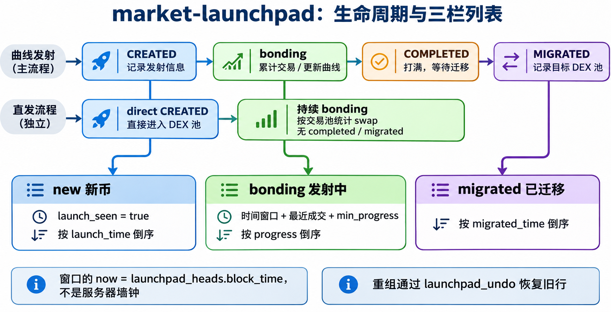

# market-launchpad：发射平台生命周期与三栏数据

`market-launchpad` 从原始链 topic 的 `launchpad_events` 和 pool trades 中，跟踪新币从发射、曲线交易、打满到 DEX 迁移的过程，也支持没有 bonding curve、发射即进入 DEX 池的 direct launch。

| 项目 | 内容 |
| --- | --- |
| 启动入口 | `cmd/market-launchpad`；默认配置 `configs/market-launchpad.yaml` |
| 业务代码 | `internal/app/launchpad/biz/launchpad.go` |
| 存储代码 | `internal/app/launchpad/data/launchpad.go` |
| 输入 | 原始链 topic 的 launchpad events、trades 和块时间 |
| 输出 | PostgreSQL `launchpad_tokens`、`launchpad_heads`、`launchpad_protocols`、`launchpad_undo`、`launchpad_checkpoints` |
| 下游 | market-api 的 new / bonding / migrated 列表和单币曲线详情 |



## 1. 支持的两种发射模式

### 1.1 曲线发射

four.meme、Flap、Pons 等平台的代币先在作用域池 `<manager>:<token>` 上交易。交易的 `pool_state.curve` 给出交易后的曲线状态：

```text
CREATED → bonding → COMPLETED/completed → MIGRATED/migrated
```

状态只前进、不后退。若只收到 `MIGRATED`，也会直接进入 migrated 并记录目标 DEX 池，不要求之前一定见过 completed。

### 1.2 直发（direct）

Bankr、Long.xyz、Clanker、pools.trade、Zora 等平台的 `CREATED` 事件可带 `direct` 和 `trading_pool_id`。这类代币：

- 发射后直接在 DEX 池交易，没有曲线打满和迁移阶段；
- 一直保持 `bonding`，不是说它仍在一条虚拟曲线上，而是复用列表生命周期；
- 交易池中的 swap 才计入 trades / buys / sells；liquidity add / remove 不计；
- 代币流出池子（池视角数量为负）记为 buy，否则记为 sell；
- 启动时从 `launchpad_tokens` 重建 `trading_pool_id → token` 映射，重启后不需要重放 CREATED 才能识别后续交易。

## 2. 基本流程

1. `chainsync` 按 offset 提供区块；每块新建一个按 token 聚合的 collector。
2. 先处理全部 launchpad events，登记 CREATED、direct 交易池和状态推进。
3. 再处理 trades：direct 池按映射归属；曲线交易按 curve state 或 `launchpad.protocols` 中的协议识别。
4. 每个代币每块只产生一条 change；曲线值取块内最后有效交易后的状态，计数器累加，最后成交时间取块时间。
5. 对非 bonding 且尚未有 progress 的行补为 1e18，确保已打满 / 已迁移代币不会因缺少最后一笔状态而显示 0%。
6. 存储层保存块前 undo、合并代币行、补充协议集合、更新链头，并与检查点在同一事务中提交。

“先事件、后交易”也让 direct CREATED 所在块的池交易立即计入，不必等下一块。

## 3. 核心规则

### 3.1 曲线值的单位与覆盖

- `progress` 是 wad 整数：`1e18 = 100%`；API 返回时转为小数。
- `base_remaining`、`quote_raised` 是最小单位原始整数。
- `price` 是每 `1e18` 最小单位 base 对应的 quote 最小单位数，不是 USD，也不是每人类单位 base 的价格。
- 本块 change 中为 `NULL` 的曲线字段不清空旧值；非空时才覆盖。
- trades / buys / sells 是累计计数，不是本块值；重组时靠恢复整行撤销累计。

### 3.2 晚发现的代币

若服务没见过 CREATED，却先看到曲线或已映射池的交易，会以当前块建立近似发射记录：

- `launch_height` / `launch_time` 是当前块；
- `launch_seen=false`；
- 不进入 `new` 栏，避免把老币突然当成“刚刚真实发射”。

以后若收到真正的 CREATED，会用真实发射高度和时间替换近似值，并将 `launch_seen` 置真。

### 3.3 direct 的“进度”不是曲线进度

direct 行的 `progress` 通常不由链上曲线提供，market-api 读取时计算伪进度：

- 有有效 `launch_start < launch_end`：按链头时间在发射窗口中的位置推进，例如 Long.xyz epoch；
- 没有窗口：`USD price × launch pool total_supply / target_fdv_usd`；价格来自 rankings，total_supply 来自池 metadata，目标由 `api.launchpad` 配置；
- 价格、decimals 或 supply 任一未知时，进度为 `null`，不猜成 0；
- 计算结果 capped 在 100%，用于排序和筛选，但 direct 生命周期仍保持 bonding。

### 3.4 列表以链头时间为“现在”

三栏的 max age / stale 不使用 API 服务器的墙钟，而使用 `launchpad_heads.block_time`。这样重放历史或服务追块时，列表展示的是“当时链头会看到什么”，不会让所有历史币瞬间过期。

## 4. 表与字段

### 4.1 `launchpad_tokens`

主键：`(chain_id, token)`。每个发射平台代币一行当前状态。

| 字段 | 类型 | 含义 |
| --- | --- | --- |
| `chain_id` | `BIGINT` | 链 ID |
| `token` | `TEXT` | 发射代币地址 |
| `protocol` | `TEXT` | 平台协议名，小写，如 `fourmeme`、`flap`、`pons`、`bankr` |
| `pool_id` | `TEXT` | 发射事件所属的作用域池 / 发射池 ID；曲线常为 `<manager>:<token>` |
| `manager` | `TEXT` | 平台 manager 合约地址；曲线池可从 pool ID 前缀获得 |
| `quote` | `TEXT` | 曲线计价币地址；direct 可来自发射事件身份 |
| `creator` | `TEXT NULL` | 创建者地址；未知为 `NULL` |
| `name` / `symbol` | `TEXT NULL` | 发射事件携带的名称 / 符号；API 可用 registry 值兜底 |
| `meta_uri` | `TEXT NULL` | 平台提供的元数据 URI |
| `launch_tx` | `TEXT NULL` | CREATED 所在交易哈希 |
| `launch_seen` | `BOOLEAN` | 是否真正观察到 CREATED；false 表示交易触发的近似发现 |
| `launch_height` | `BIGINT` | 真实发射块高，或首次见交易时的近似块高 |
| `launch_time` | `BIGINT` | 发射块 Unix 秒；列表窗口和 new 排序使用 |
| `status` | `TEXT` | `bonding` / `completed` / `migrated`；只前进 |
| `progress` | `NUMERIC(78,0) NULL` | 曲线 wad 进度；direct 伪进度通常在查询时计算，不能误把此列当 direct 最终进度 |
| `base_remaining` | `NUMERIC(78,0) NULL` | 最新已知曲线剩余可售 base 原始整数 |
| `quote_raised` | `NUMERIC(78,0) NULL` | 最新已知已募集 quote 原始整数 |
| `price` | `NUMERIC(78,0) NULL` | 最新曲线原始价格，单位见第 3.1 节 |
| `trades` | `BIGINT` | 纳入发射统计的 swap 总数；累计值 |
| `buys` / `sells` | `BIGINT` | 按代币流出 / 流入池子判定的累计买卖笔数 |
| `last_trade_time` | `BIGINT NULL` | 最近纳入统计的 swap 所在块 Unix 秒；bonding 栏 stale 过滤使用 |
| `completed_height` | `BIGINT NULL` | 首次进入 completed 或更晚状态的应用高度；若只见迁移可与迁移高度相同 |
| `completed_time` | `BIGINT NULL` | 上述状态变化的 Unix 秒 |
| `migrated_height` | `BIGINT NULL` | 首次观察到 migrated 的块高 |
| `migrated_time` | `BIGINT NULL` | 迁移块 Unix 秒；migrated 栏窗口与排序使用 |
| `target_pool_id` | `TEXT NULL` | 曲线迁移到的目标 DEX 池 |
| `updated_height` | `BIGINT` | 最近一次修改该代币行的应用高度 |
| `direct` | `BOOLEAN NULL` | `TRUE` 表示直发；曲线及旧数据可为 `NULL`，使用方应按是否真值判断 |
| `trading_pool_id` | `TEXT NULL` | direct 实际交易池 ID；用于启动重建映射和查询归属 |
| `launch_start` | `BIGINT NULL` | direct 平台发射窗口起点，Unix 秒 |
| `launch_end` | `BIGINT NULL` | direct 平台发射窗口终点，Unix 秒；必须大于 start 才记录窗口 |

索引与三栏一一对应：`new` 使用 bonding 上的 launch time 部分索引，`bonding` 使用 bonding/completed 上的 progress 部分索引，`migrated` 使用 migrated time 部分索引；另有 trading pool 部分索引服务 direct 交易映射。

### 4.2 `launchpad_heads`

主键：`chain_id`。

| 字段 | 类型 | 含义 |
| --- | --- | --- |
| `chain_id` | `BIGINT` | 链 ID |
| `block_height` | `BIGINT` | 最新实际应用块高；回滚时最多降回 rollback 高度 |
| `block_time` | `BIGINT` | 最新实际应用块的 Unix 秒，作为列表的“now” |

回滚时高度会下降，但时间在替换分支首块到来前保留最后已知值，因此短暂窗口内最多比回滚点超前一个重组深度；不是重新扫描旧块来求时间。

### 4.3 `launchpad_protocols`

主键：`(chain_id, protocol)`。

| 字段 | 类型 | 含义 |
| --- | --- | --- |
| `chain_id` | `BIGINT` | 链 ID |
| `protocol` | `TEXT` | 至少有一个代币出现过的平台；供 API 平台筛选器使用 |

协议集合只增不删，重组也不会移除曾经出现过的平台。首次增加此表时会从已有 `launchpad_tokens` 去重回填。

### 4.4 `launchpad_undo`

主键：`(chain_id, block_height, token)`。

| 字段 | 类型 | 含义 |
| --- | --- | --- |
| `chain_id` | `BIGINT` | 链 ID |
| `block_height` | `BIGINT` | 某块第一次修改该代币的高度 |
| `token` | `TEXT` | 被修改代币 |
| `prev` | `JSONB NULL` | 块前完整代币行；`NULL` 表示当时不存在，回滚删除当前行 |

### 4.5 `launchpad_checkpoints`

| 字段 | 类型 | 含义 |
| --- | --- | --- |
| `chain_id` | `BIGINT` | 链 ID，主键 |
| `kafka_offset` | `BIGINT` | 最后提交的原始流 offset；文件源时为记录序号 |
| `block_height` | `BIGINT` | 最后应用高度 |
| `block_hash` | `TEXT` | 最后应用块哈希；有效回滚后清空 |
| `pruned_through` | `BIGINT` | undo 已裁剪到的高度，只增不减 |
| `updated_at` | `TIMESTAMPTZ` | 最后提交时间 |

## 5. 三栏列表如何读这些字段

`GET /v1/chains/{chain}/launchpad/tokens?column=...`：

| column | 主要条件 | 排序 |
| --- | --- | --- |
| `new` | `status=bonding`、`launch_seen=true`、`head_time-launch_time <= max_age` | `launch_time` 新到旧 |
| `bonding` | `status IN (bonding, completed)`、发射在 `max_age` 内、`last_trade_time` 在 `stale` 内、进度达到 `min_progress` | `progress` 高到低 |
| `migrated` | `status=migrated` 且迁移在 `migrated_age` 内 | `migrated_time` 新到旧 |

`protocol` 过滤平台，`limit` 默认 50、最多 1000。窗口可以写 Unix 秒数或 Go duration，最大 720h。响应还会联读 registry、rankings 和 quote 元数据，因此 `launchpad_tokens` 不是全部响应字段的唯一来源。

目前列表通过轮询刷新，没有专用 launchpad live channel。

## 6. 设计巧思与一致性边界

- **每币每块一条 change**：天然对应 undo 主键，避免同一块重复保存中间镜像。
- **状态单调而字段可补全**：状态不被迟到事件倒退，但 creator、launch metadata、真实 launch 时间仍可后补。
- **近似发现与真实发射分离**：`launch_seen` 让历史回填不会污染新币栏。
- **direct 复用同一数据模型**：列表、筛选和 API 不需另起服务，但用 `direct` / `trading_pool_id` 保留语义差异。
- **链时间而非墙钟**：回放、追块和实时运行使用同一套列表逻辑。
- **有限 undo 深度**：裁剪到 `max(finalized, height-history_depth)`；过深回滚停止，不猜旧状态。
- **只推进 checkpoint 的提交不动业务行**：chainsync 跳过重复块时，head 和 token 不应被重写。

## 7. 配置与代码索引

| 配置 | 默认 | 说明 |
| --- | --- | --- |
| `launchpad.protocols` | `[fourmeme, flap, pons]` | 即使交易没有 curve state，也将这些协议的合格 swap 计为曲线交易 |
| `launchpad.history_depth` | 256 | 至少覆盖上游 `scanner.cache_size` |
| `api.launchpad.target_fdv_usd` | 69000 | 不属于本服务写入端；market-api 计算 direct 伪进度的默认目标 |
| `api.launchpad.protocol_target_fdv_usd` | `poolstrade: 50000` | 按平台覆盖目标 |

| 关注点 | 路径 |
| --- | --- |
| 事件、曲线、direct 交易归属 | `internal/app/launchpad/biz/launchpad.go` |
| 当前行合并、undo、head | `internal/app/launchpad/data/launchpad.go` |
| 列表查询与 direct 伪进度 | `internal/app/api/data/launchpad.go` |
| 三栏 HTTP 参数与响应 | `internal/app/api/service/launchpad.go` |
| DDL 与部分索引 | `internal/pkg/pgdb/schema.go` |
