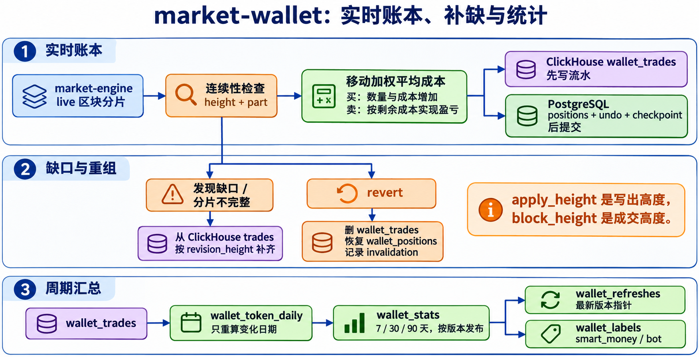

# market-wallet：钱包成本账本、统计与标签

`market-wallet` 回答“哪个钱包在什么代币上赚了多少钱”。它跟随 market-engine 的 live topic，用移动加权平均成本维护钱包 × 代币账本，保存逐笔账本流水，并周期生成 7 / 30 / 90 天统计及 `smart_money` / `bot` 标签。

| 项目 | 内容 |
| --- | --- |
| 启动入口 | `cmd/market-wallet`；默认配置 `configs/market-wallet.yaml` |
| 业务代码 | `internal/app/wallet/biz` |
| 数据代码 | `internal/app/wallet/data` |
| 输入 | market-engine 的 Kafka live topic；ClickHouse `trades` / `blocks` 用于补缺和首次回放 |
| PostgreSQL 输出 | `wallet_positions`、`wallet_undo`、`wallet_checkpoints`、`wallet_pending_invalidations`、`wallet_labels` |
| ClickHouse 输出 | `wallet_trades`、`wallet_token_daily`、`wallet_stats`、`wallet_refreshes`、`wallet_invalidations` |
| 下游 | market-api 的钱包画像、排行、代币盈利榜、交易与持有人标签、按钱包 / 标签推送 |



## 1. 前置依赖

market-wallet 不是直接读原始链 topic 的独立索引器，它依赖 market-engine 已经完成定方向和 USD 估值：

- market-engine 必须 `live.enabled: true`；
- 当前 follower 使用 Kafka live topic，即 `live.driver: kafka`；
- engine 必须 `storage.driver: clickhouse`，因为实时流跳过的旧块、丢失的分片和首次启动历史都从 ClickHouse `trades` 补；
- 两端的 chain、`topic` / `live_topic`、Kafka brokers 必须一致。

如果只需要原始转账或链上余额，不应使用本组件；它保存的是交易成本账本。

## 2. 两条主流程

### 2.1 实时账本流程

1. 启动时读取 `wallet_checkpoints`，并删除 ClickHouse 中该检查点之后可能已经写入但未完成 PostgreSQL 提交的 `wallet_trades`。
2. 有检查点时从 live offset + 1 继续；首次启动从 live 末尾等第一个 `part=0` 区块，并从 ClickHouse 回放 `wallet.history`。
3. 检查 `(height, part)` 连续性；有高度缺口或不完整前块时从 ClickHouse 按 `revision_height` 补齐。
4. 过滤出可记账的 buy / sell，加载涉及的当前 positions，在内存里逐笔应用移动加权平均成本。
5. 每个 `(height, wallet, token)` 第一次变化前保存旧 position 为 undo。
6. flush 时**先写 ClickHouse `wallet_trades`**，再在 PostgreSQL 一个事务中写 positions、undo、checkpoint。
7. 接近链头时每个 live 记录提交；追块时按 `flush_rows` / `flush_interval` 攒批。

### 2.2 周期统计与标签流程

1. 读取 `wallet_trades` 的最新成交时间和最高 `apply_height`。
2. 确定本轮需要重算的最早日期，删除并重写该日期起的 `wallet_token_daily`。
3. 以最新成交所在 UTC 日为窗口终点，分别汇总 7 / 30 / 90 天，写入同一新 `version` 的 `wallet_stats`。
4. 根据该版本计算 bot 与 smart money 名单。
5. 向 `wallet_refreshes` 写入新版本，使 API 可以看到完整的一代统计。
6. 在 PostgreSQL 替换 `source='rule'` 的标签，保留仍符合标签的原始 since，不动其它 source。
7. 只保留当前与上一代 `wallet_stats` 分区，避免某读者刚取得旧版本指针后数据立刻消失。

没有账本流水时，统计 refresher 不做任何事。

## 3. 核心账本算法

### 3.1 哪些交易进入账本

必须同时满足：

- `side` 是 buy 或 sell，流动性增减不进入；
- `trader` 和 `base_token` 非空；
- `base_amount > 0`、`value_usd > 0`；
- `outlier=false`。

因此未定价、异常价或没有 trader 的操作不会制造虚假成本 / 盈亏。钱包身份是上游的 `trader`（交易发送方），不是 Transfer 的每个接收方。

### 3.2 买入：移动加权平均成本

设原持仓数量 `Q`、剩余成本 `C`，买入数量 `a`、USD 金额 `v`：

```text
Q' = Q + a
C' = C + v
平均成本 = C' / Q'
```

从零变正是 `open`，已有持仓再买是 `add`。`first_buy_*` 记录账本首次买入；`opened_at` 记录当前这一轮持仓从零开始的时间，清仓后清空。

### 3.3 卖出：只给有成本的部分实现盈亏

常规卖出先取 `costed = min(a, Q)`：

```text
cost_sold = C × costed / Q
proceeds  = V × costed / a     -- a > Q 时，只分配有成本部分的收入
realized  = proceeds - cost_sold
Q'        = Q - costed
C'        = C - cost_sold
```

卖出不改变剩余持仓的平均成本。超出 Q 的部分可能来自转入或空投，只增加 sold amount / volume，不计算盈亏。

- 有成本且未清完：`reduce`；
- 有成本且清完：`close`；
- 本来就没有有成本持仓：`untracked`，`counted=false`，不计胜率和 realized PnL；
- 卖出后残余不超过 `close_ratio × 原持仓` 时按 dust 清仓，剩余成本全部结转，避免零头永远显示 open。

`counted=true` 的卖出中，`realized_usd > 0` 才记 win，其余（包括恰好为 0）记为非盈利卖出。胜率是按卖出笔数 `wins / counted`，不是按盈利代币数。

## 4. 高度、分片、补缺与重组

### 4.1 两套高度

| 高度 | 含义 |
| --- | --- |
| `block_height` | 成交实际发生的块高；用于钱包历史、日汇总和展示 |
| `apply_height` | wallet 实际应用该成交的高度；来自 engine 的 `revision_height`；用于崩溃恢复和回滚 |

迟到精度交易可能发生在 100 块，却在 110 块才被 engine 写出；wallet 流水中就是 `block_height=100, apply_height=110`。回滚 105 块时必须删除它，尽管成交块高小于 105。

### 4.2 为什么 checkpoint 有 part / parts

一个 live 区块可以拆成多条记录。`part` 是当前分片序号，`parts` 是该块总分片数；`part=-1` 是内部 `WholeBlock` 标记，表示从 ClickHouse 补齐或回滚到的完整高度。

如果下一个高度到来时前一块还没收齐，follower 不会带着半块继续：先回滚不完整块，再从 ClickHouse 将该块及缺口一起补齐。同一高度分片不连续且不能按规则补齐时停止。

### 4.3 跨 ClickHouse / PostgreSQL 的恢复

正常提交顺序是：

```text
INSERT wallet_trades → PostgreSQL TX(positions + undo + checkpoint)
```

崩溃可能留下“流水已写、账本未提交”。下次启动按 checkpoint 的 `(block_height, part)` 对应的 apply 坐标删除多余流水，再重放，避免重复记账。

回滚则先删 `apply_height > rollback_to` 的流水，再用 `wallet_undo` 恢复 positions 并保存 checkpoint。undo 以 apply height 记录，裁剪至 `max(finalized, height-history_depth)`；过深回滚报 `ErrReorgTooDeep`。

## 5. PostgreSQL 表与字段

### 5.1 `wallet_positions`

主键：`(chain_id, wallet, token)`。这是当前成本持仓与历史累计计数，不是窗口统计。

| 字段 | 类型 | 含义 |
| --- | --- | --- |
| `chain_id` | `BIGINT` | 链 ID |
| `wallet` | `TEXT` | trader 地址 |
| `token` | `TEXT` | base 代币地址 |
| `quantity` | `NUMERIC` | 当前**有成本**持仓数量；转入 / 空投不增加它，因此不等于链上余额 |
| `cost_usd` | `NUMERIC` | `quantity` 对应的剩余 USD 成本；卖出按比例扣减，清仓为 0 |
| `realized_usd` | `NUMERIC` | 该钱包该代币自账本建立以来累计已实现盈亏 |
| `bought_qty` / `sold_qty` | `NUMERIC` | 累计买入 / 卖出 base 数量；卖出包含无成本部分 |
| `bought_usd` / `sold_usd` | `NUMERIC` | 累计买入 / 卖出 USD 成交额；卖出包含 untracked 部分 |
| `buys` / `sells` | `BIGINT` | 累计纳入账本的买 / 卖笔数 |
| `wins` | `BIGINT` | 累计 `counted && realized_usd>0` 的卖出笔数 |
| `losses` | `BIGINT` | 累计 counted 但未盈利的卖出笔数，含盈亏为 0 |
| `first_buy_height` | `BIGINT` | 账本首次买入高度；0 表示尚无买入 |
| `first_buy_time` | `TIMESTAMPTZ NULL` | 首次买入块时间 |
| `opened_at` | `TIMESTAMPTZ NULL` | 当前持仓轮次开始时间；清仓后为 `NULL` |
| `last_trade_time` | `TIMESTAMPTZ` | 最近纳入账本交易时间；钱包持仓列表按它排序 |
| `updated_height` | `BIGINT` | 最近修改该行的 live / 回放 apply 高度 |

平均成本为 `cost_usd / quantity`。market-api 联读 rankings 最新价计算未实现盈亏：`quantity × price_usd - cost_usd`；没有现价时未实现盈亏为 `null`。

### 5.2 `wallet_undo`

主键：`(chain_id, block_height, wallet, token)`；这里的 `block_height` 实际是 apply / revision 高度。

| 字段 | 类型 | 含义 |
| --- | --- | --- |
| `chain_id` | `BIGINT` | 链 ID |
| `block_height` | `BIGINT` | 该持仓在该 apply 高度第一次变化之前所对应的高度 |
| `wallet` / `token` | `TEXT` | 被修改持仓键 |
| `prev` | `JSONB NULL` | 完整旧 position 行；`NULL` 表示此前不存在 |

同一高度跨多个 live 分片或多次 flush 修改同一持仓时，`ON CONFLICT DO NOTHING` 保留最早的块前状态。

### 5.3 `wallet_checkpoints`

主键：`chain_id`。

| 字段 | 类型 | 含义 |
| --- | --- | --- |
| `chain_id` | `BIGINT` | 链 ID |
| `kafka_offset` | `BIGINT` | 最后完整提交的 live topic offset；不是原始链 topic offset |
| `block_height` | `BIGINT` | 最后应用的 apply / revision 高度 |
| `part` | `INT` | 最后应用的分片；`-1` 表示完整高度 |
| `parts` | `INT` | 当前区块总分片数；0 表示未知或 WholeBlock |
| `pruned_through` | `BIGINT` | undo 已裁剪到的 apply 高度，只增不减 |
| `updated_at` | `TIMESTAMPTZ` | 最后提交时间 |

### 5.4 `wallet_pending_invalidations`

主键：`chain_id`。

| 字段 | 类型 | 含义 |
| --- | --- | --- |
| `chain_id` | `BIGINT` | 链 ID |
| `day` | `DATE` | 即将 / 已经删除的流水中最早的 UTC 成交日；多次范围合并取更早者 |
| `height` | `BIGINT` | 删除后保留的最高 apply 高度；多次范围合并取更低者 |

删除流水前先写它，删除并发布 ClickHouse invalidation 后才清除。若中途崩溃，重做删除时已找不到原流水，也能靠此 pending 行补发统计失效范围。

### 5.5 `wallet_labels`

主键：`(chain_id, wallet, label)`。

| 字段 | 类型 | 含义 |
| --- | --- | --- |
| `chain_id` | `BIGINT` | 链 ID |
| `wallet` | `TEXT` | 钱包地址 |
| `label` | `TEXT` | 标签名，如 `smart_money`、`bot` |
| `source` | `TEXT` | 来源；规则计算为 `rule`，人工维护可为 `manual` |
| `since` | `TIMESTAMPTZ` | 标签首次生效时间；规则刷新仍符合时保留原值 |

只删除不再符合的 `rule` 标签。若同名标签已以人工来源存在，规则不会覆盖它的 source / since，也不会把它当作过期 rule 标签删除。

## 6. ClickHouse 表与字段

### 6.1 `wallet_trades`

每行是一笔成交应用到账本后的结果。排序键以 `(chain_id, wallet, block_time, block_height, log_index, operation_index)` 服务钱包历史。

| 字段 | 类型 | 含义 |
| --- | --- | --- |
| `chain_id` | `UInt64` | 链 ID |
| `apply_height` | `Int64` | 实际写入账本的高度，对应 engine revision；恢复和回滚按它删除 |
| `part` | `Int32` | 带来该成交的 live 分片；WholeBlock 回放为 -1 |
| `block_height` | `Int64` | 成交实际发生高度 |
| `block_time` | `DateTime('UTC')` | 成交块时间；月分区、日汇总与 TTL 依据 |
| `transaction_hash` | `String` | 成交交易哈希 |
| `log_index` / `operation_index` | `UInt32` | 日志与操作序号，和块高共同用于翻页次序 |
| `wallet` | `String` | 记账钱包，即 trader |
| `token` | `String` | base 代币 |
| `quote_token` | `String` | 原成交的 quote 代币 |
| `pool_id` | `String` | 成交池 ID |
| `side` | `Enum8` | `buy` 或 `sell` |
| `event` | `Enum8` | `open` / `add` / `reduce` / `close` / `untracked` |
| `amount` | `Decimal256(36)` | 本笔 base 成交数量 |
| `value_usd` | `Decimal256(18)` | 本笔总 USD 成交额，包括可能不计 PnL 的部分 |
| `price_usd` | `Decimal256(18)` | 本笔 base USD 单价 |
| `realized_usd` | `Decimal256(18)` | 本笔有成本卖出部分的已实现盈亏；仅 counted 时有意义 |
| `cost_sold_usd` | `Decimal256(18)` | 本笔结转的成本；仅 counted 时有意义 |
| `counted` | `Bool` | 是否计入已实现盈亏、胜率和成本收益统计 |
| `hold_seconds` | `Int64` | close 时当前轮持仓秒数；其它事件为 0 |
| `quantity_after` | `Decimal256(36)` | 本笔后的有成本持仓数量 |
| `cost_after` | `Decimal256(18)` | 本笔后的剩余成本 |

`apply_height` 上有 minmax 索引支持恢复 / 补缺，`token` 上有 bloom filter 支持代币过滤。`wallet.trades_days` 设置按成交时间的 TTL，必须长于最大统计窗口。

### 6.2 `wallet_token_daily`

一行是某 UTC 日、某钱包、某代币的汇总。变化日期会整体删除后从 `wallet_trades` 重算，因此它不是只增不改的不可变事实。

| 字段 | 类型 | 含义 |
| --- | --- | --- |
| `chain_id` | `UInt64` | 链 ID |
| `day` | `Date` | UTC 成交日；月分区依据 |
| `wallet` / `token` | `String` | 钱包与 base 代币 |
| `buys` / `sells` | `UInt64` | 当日买 / 卖笔数 |
| `bought_usd` / `sold_usd` | `Decimal256(18)` | 当日买 / 卖 USD 成交额 |
| `realized_usd` | `Decimal256(18)` | 当日 counted 卖出的已实现盈亏之和 |
| `cost_sold_usd` | `Decimal256(18)` | 当日 counted 卖出结转成本之和；用于代币 ROI 分桶 |
| `wins` | `UInt64` | 当日 counted 且 realized > 0 的卖出数 |
| `counted` | `UInt64` | 当日计入盈亏的卖出总数 |
| `closes` | `UInt64` | 当日 close 事件数 |
| `hold_seconds` | `UInt64` | 当日 close 的持仓秒数总和；负值在 SQL 中被截为 0 |
| `fast_closes` | `UInt64` | 当日 `hold_seconds <= fast_close_seconds` 的 close 数 |

### 6.3 `wallet_stats`

一行是一个钱包在一个 `window_days` 窗口、一个汇总版本下的统计。

| 字段 | 类型 | 含义 |
| --- | --- | --- |
| `chain_id` | `UInt64` | 链 ID |
| `window_days` | `UInt16` | 统计窗口天数，如 7 / 30 / 90 |
| `wallet` | `String` | 钱包地址 |
| `realized_usd` | `Decimal256(18)` | 窗口内已实现盈亏之和 |
| `bought_usd` / `sold_usd` | `Decimal256(18)` | 窗口内买 / 卖成交额；API 的 ROI 使用 `realized / bought` |
| `buys` / `sells` | `UInt64` | 窗口内买 / 卖笔数 |
| `wins` / `counted` | `UInt64` | 窗口内盈利卖出数 / 计入盈亏卖出数；胜率 = wins / counted |
| `tokens` | `UInt64` | 窗口内有账本活动的不同代币数 |
| `tokens_over_5x` | `UInt64` | 代币级 `realized / cost_sold > 5` 的代币数 |
| `tokens_2x_to_5x` | `UInt64` | 上述 ROI `>2 且 <=5` 的代币数 |
| `tokens_0_to_2x` | `UInt64` | 上述 ROI `>=0 且 <=2` 的代币数 |
| `tokens_loss_50` | `UInt64` | 上述 ROI `>=-0.5 且 <0` 的代币数 |
| `tokens_loss_over` | `UInt64` | 上述 ROI `<-0.5` 的代币数；smart money 的亏损占比使用它 |
| `closes` | `UInt64` | 窗口内清仓数 |
| `hold_seconds` | `UInt64` | 窗口内清仓持仓秒数总和 |
| `fast_closes` | `UInt64` | 窗口内快进快出清仓数 |
| `version` | `UInt64` | 汇总版本，Unix 毫秒；与 chain 一起构成物理分区 |

没有 `cost_sold` 的代币 ROI 为 NaN，不进入五个收益桶。整个表读法是先查 `wallet_refreshes` 最新 version，再读该 version；不能只按 wallet 查询，否则可能混到旧版本。

### 6.4 `wallet_refreshes`

| 字段 | 类型 | 含义 |
| --- | --- | --- |
| `chain_id` | `UInt64` | 链 ID，ReplacingMergeTree 排序键 |
| `version` | `UInt64` | 本轮统计版本，Unix 毫秒，也是合并版本 |
| `started` | `UInt64` | 开始读取流水前的 Unix 毫秒；下轮只接受之后的 invalidation |
| `head_time` | `DateTime('UTC')` | 本轮最新成交块时间，不是链最新块或墙钟 |
| `apply_height` | `Int64` | 本轮看到的最高 apply 高度；下轮从它（含）检查迟到分片 / 旧成交 |

### 6.5 `wallet_invalidations`

| 字段 | 类型 | 含义 |
| --- | --- | --- |
| `chain_id` | `UInt64` | 链 ID |
| `at` | `UInt64` | 失效记录发布时间，Unix 毫秒；必须在删除完成后，供下轮按 started 过滤 |
| `day` | `Date` | 被删除流水中最早的 UTC 成交日 |
| `height` | `Int64` | 删除后保留的最高 apply 高度；帮助下轮捕获重新写入的旧成交 |

记录 TTL 为 30 天；`wallet_stats` 版本另有 7 天 TTL 兜底。

## 7. 增量统计的巧思

首次汇总重算最长窗口。后续轮次不会盲目全量，也不会只看“最新一天”，而是取以下候选中最早的受影响日，并截断在最长窗口内：

- 上次最新成交日的前一天：覆盖跨日边界和仍在变化的尾部；
- 上次 started 之后 invalidation 的最早日：覆盖回滚与崩溃删除；
- 从上次最高 apply height（含）写入的最早成交日：覆盖同块后到的分片，以及 apply 较晚但成交较早的回填。

然后只重建这些日期的日表，再生成所有窗口的新版本。这是 `apply_height`、pending invalidation 和 refresh started 三个坐标共同保证的增量正确性。

## 8. 标签规则与边界

| 标签 | 当前默认规则 |
| --- | --- |
| `bot` | 7 天内 buys+sells ≥ 2000；或 closes ≥ 10 且 fast_closes/closes ≥ 30% |
| `smart_money` | 30 天内 realized ≥ $5000、counted>0 且胜率 ≥50%、tokens ≥10、`tokens_loss_over/tokens <=30%`、不满足 bot；按 realized 取前 1000 |

- 统计窗口从最新成交日倒数，不按服务器墙钟，因此追块 / 回放语义稳定。
- 统计和标签是周期最终一致，不随每一笔交易立刻更新；API 的标签缓存还每分钟刷新一次。
- `wallet_positions.quantity` 不等于 holder-indexer 的真实余额；成本账本不知道无 DEX 成本来源的代币。
- 已排除的异常价和无 USD 价交易不会进入胜率 / PnL，避免“价格垃圾进、聪明钱垃圾出”。
- 当前不做资金来源聚类、KOL 名单和关注列表。

## 9. 配置与代码索引

| 配置 | 默认 | 说明 |
| --- | --- | --- |
| `wallet.history` | 2160h（90 天） | 首次启动从 ClickHouse 回放时长 |
| `wallet.history_depth` | 256 | 可撤销 apply 高度深度，至少覆盖上游 scanner cache |
| `wallet.backfill_heights` | 2000 | 每次补缺读取的高度数 |
| `wallet.batch_lag` / `flush_rows` / `flush_interval` | 1m / 20000 / 5s | 追块批量提交 |
| `wallet.close_ratio` | 0.001 | 残余不超过原持仓 0.1% 时按清仓 |
| `wallet.trades_days` | 120 | 流水 TTL，须覆盖最长统计窗口 |
| `wallet.stats.refresh_interval` | 15m | 统计与标签刷新周期 |
| `wallet.stats.windows` | `[7,30,90]` | 必须包含 smart money 与 bot 各自窗口 |

| 关注点 | 路径 |
| --- | --- |
| 移动加权成本 | `internal/app/wallet/biz/ledger.go` |
| live 分片、补缺、提交与回滚 | `internal/app/wallet/biz/follower.go` |
| 日汇总、版本与标签编排 | `internal/app/wallet/biz/stats.go` |
| 跨库账本与 invalidation | `internal/app/wallet/data/ledger.go` |
| 统计 SQL 与规则 | `internal/app/wallet/data/stats.go` |
| DDL | `internal/pkg/pgdb/wallet.go`、`internal/pkg/chdb/wallet.go` |
