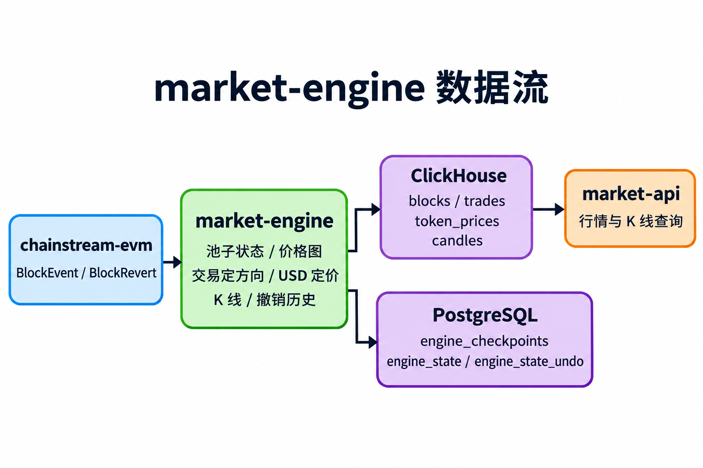
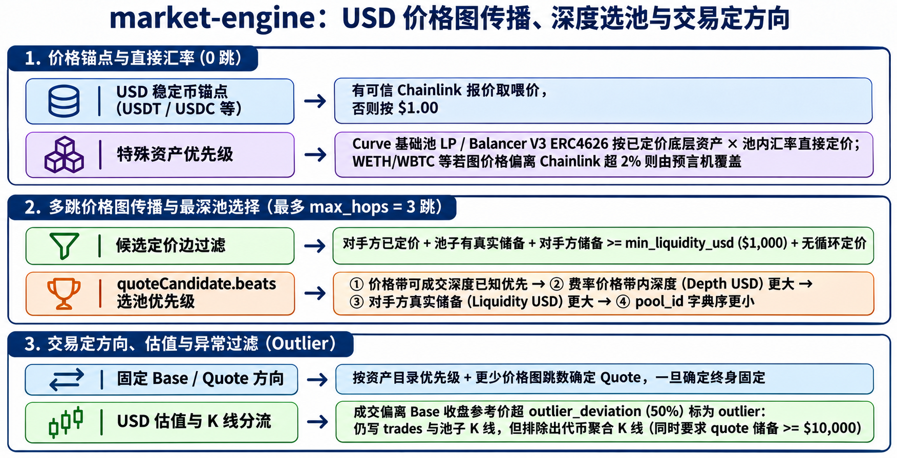
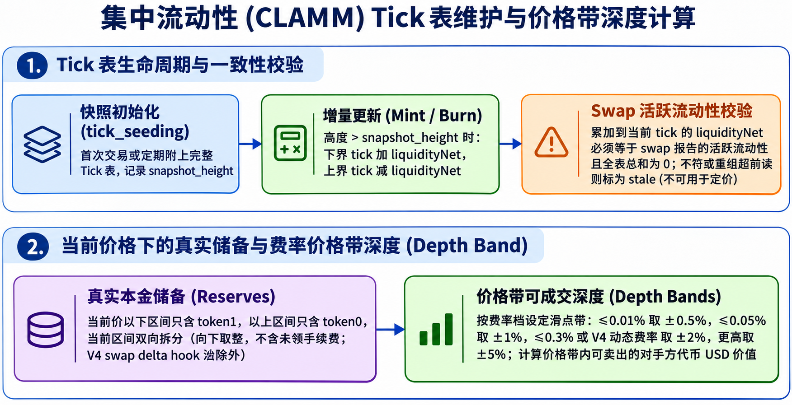
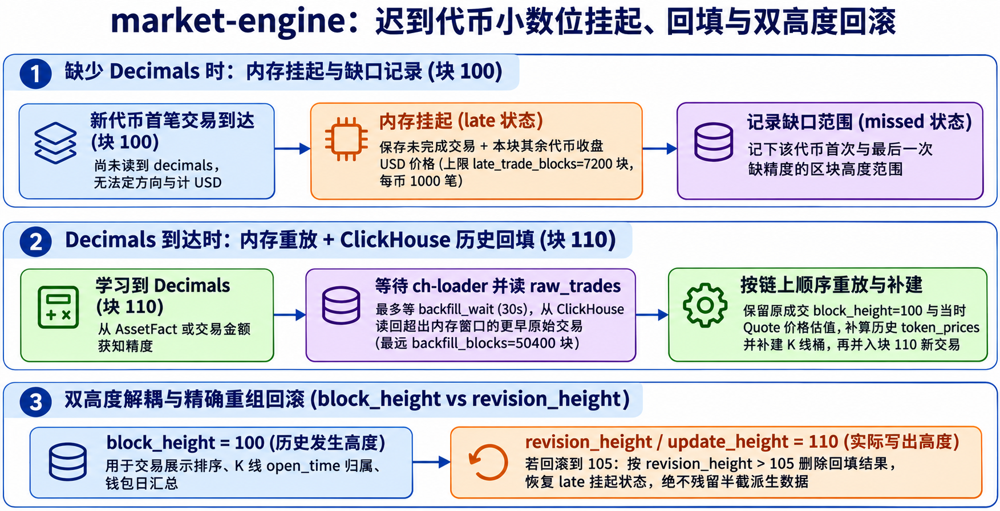
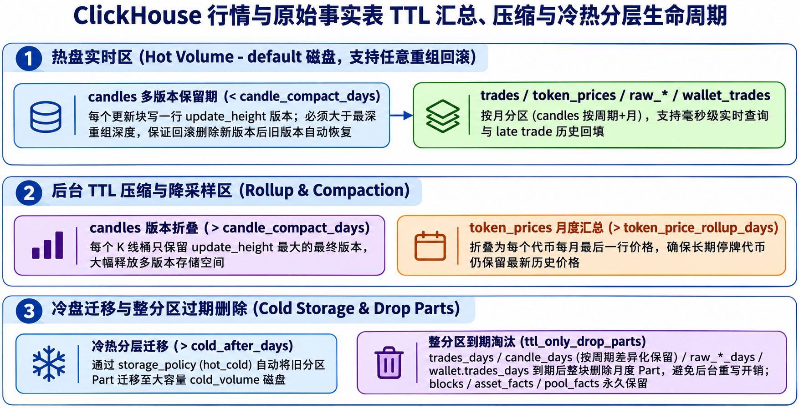

# market-engine：定价与 K 线深度专题

`market-engine` 为每条链运行独立的顺序消费循环，按 offset 读该链的 topic，把 `chainstream-evm` 发布的原始交易变成**定好方向、带 USD 价值的交易**、**代币价格**和 **K 线**，写入 ClickHouse，并把实时消息发到 live topic。



若需要逐表逐字段字典和组件级启动 / 提交流程，见 [market-engine 组件手册](components/market-engine.md)。

代码位置：

| 路径 | 内容 |
| --- | --- |
| `cmd/market-engine` | 入口与 Wire 装配 |
| `internal/app/engine/biz/processor.go` | `Processor`：每块的定价流程（`Apply` / `Revert`） |
| `internal/app/engine/biz/journal.go` | 按高度记录的撤销日志，所有状态都放在里面 |
| `internal/app/engine/biz/pool.go`、`clamm.go` | 池子状态、集中流动性 tick 表与深度 |
| `internal/app/engine/biz/balances.go`、`selection.go` | Curve / Balancer 余额快照池的价格与深度、按深度选择定价池 |
| `internal/app/engine/biz/late.go`、`backfill.go` | 迟到的代币小数位：挂起、回放、回填 |
| `internal/app/engine/biz/handler.go` | 把 `Processor` 接入 chainsync 的 `Handler` |
| `internal/app/engine/data` | ClickHouse / 内存输出存储、PostgreSQL / 内存状态存储 |
| `internal/pkg/chainlink` | 启动时解析 Chainlink 代理合约的各期聚合器 |

---

## 每块的三步处理

`Processor.Apply` 对每个 `BlockEvent` 依次做三件事：



### 1. 更新池子状态

每笔两币交易都会更新所在池子的状态（`pool` 结构，已换算成人类单位）：

| 池子类型 | 价格来源 | 储备来源 | 价格带深度（Depth）来源 |
| --- | --- | --- | --- |
| 常数乘积池（Uniswap V2 一类） | `reserves_after` 之比 | `reserves_after` | 按 0.3% 费率档（±2% 价格带）公式 $B \cdot (1 - 1/\sqrt{1 + \text{band}})$ 计算 |
| 集中流动性池（Uniswap/PancakeSwap V3、Uniswap V4、PancakeSwap Infinity） | `sqrt_price_x96` | tick 表在当前价下实际持有的币量，见下文 | tick 表在当前费率档价格带内可卖出的币量 |
| Curve / Balancer 池 | 区块附带的余额快照，见[下文](#curve-与-balancer-池) | 快照中的真实余额 | StableSwap 二分求解 / Weighted 解析公式 / CryptoSwap 报价阶梯插值 |
| 发射平台曲线池（four.meme、Flap） | 交易附带的 `pool_state.curve.price`，见[下文](#发射平台曲线池) | 计价币一侧取已募集量，代币一侧取已募集量按曲线价可换的数量 | 同常数乘积池公式 |
| 其它池子（含暂时的 liquidity-book 池） | swap 成交价 | 无 | 无 |

**没有储备的池子只有价格，不能用来传播价格。** 集中流动性池在 tick 表不可用（`stale` 或未初始化）时同样如此。

`sqrt_price_x96` 换算公式：
$$\text{price} = \left(\frac{\text{sqrtPriceX96}}{2^{96}}\right)^2 \times 10^{d_0 - d_1}$$
得到 `token1 / token0` 的人类单位价格。所有除法保留 36 位小数，足以表示远低于 1 美分的长尾代币价格。

### 2. 价格图与深度选池（`quoteCandidate.beats`）

- **锚点**：资产目录（catalog）里的 USD 稳定币。有 Chainlink 喂价覆盖时取最近一次可信报价，否则按 \$1.00。
- Curve 基础池 LP 代币、Balancer V3 的 ERC4626 代币按池子报告的**汇率**定价（对比其已定价底层资产中最便宜的一个），优先于任何池子。
- 其它本块涉及的代币，通过**最深**的池子（或 Curve / Balancer 池中的某个代币对）定价：在对手方价格移动一个费率档价格带的过程中，付出的已定价对手方代币 USD 价值最多的那个。
  - 集中流动性池的深度来自 tick 表；Curve / Balancer 池见下文；只有储备的池子按 0.3% 费率档（`constantProductFee = 3000`，对应 ±2% 价格带）的常数乘积公式 $B\cdot(1 - 1/\sqrt{1 + \text{band}})$ 计算。
  - 深度未知的池子排在所有深度已知的池子之后，它们之间再按对手方储备的 USD 价值排序。
  - 比较顺序（`selection.go` 的 `quoteCandidate.beats`）：
    1. **深度是否已知**（`hasDepth == true` 优先）；
    2. **价格带内可成交深度更大**（`depthUSD` 更大者胜出）；
    3. **对手方真实储备更大**（`liquidity_usd` 更大者胜出）；
    4. **池子 ID 字典序更小**（确定性打破平局）。
- 对手方的真实余额就是价格的 `liquidity_usd`，必须达到 `min_liquidity_usd`（默认 1000）；价格离锚点最多传播 `max_hops` 跳（默认 3）。
- 不会出现循环定价：A 不会通过一个本身由 A 定价的对手方来定价。
- 包装原生币（WETH、WBNB……）和其它代币一样走价格图，原生币伪地址共享它的价格。

### 3. 交易与 K 线

- **定方向（orientation）**：每个池子的 quote 代币先按目录排名决定（稳定币 > 主流包装原生币 > 其它已定价代币），排名相同时取价格图中跳数更少的已定价代币。一旦某个交易对有了确定的 quote，方向就固定不变；还没有已知 quote 的交易对保持“临时”状态。
- **估值**：交易按本块收盘时 quote 代币的价格计 USD。
- **K 线**：
  - swap 总是进入**池子 K 线**（`subject = 'pool'`）。
  - 当池子的 quote 储备达到 `candle_min_liquidity_usd`（默认 10000）且该 swap 不是异常交易（`outlier == false`）时，也进入 base 代币的**聚合 K 线**（`subject = 'token'`）。
  - 新 K 线以前一根的收盘价开盘。
  - 周期由 `market.intervals` 决定，默认 `[1m, 5m, 15m, 1h, 4h, 24h]`。

---

## 单块完整数值推演：选池、定方向、异常过滤与 K 线分流

假设在以太坊区块 `20,000,100` 中，已知锚点 `USDC = $1.00`（0 跳），`WETH = $2,500.00`（1 跳，来自 USDC/WETH 主池），现在区块内有三个涉及代币 `TOKEN_X` 的池子发生了交易：

| 池子 | 协议与费率档 | 对手方 (Quote) | 块末池子给出的 `TOKEN_X` 价格 | 对手方真实储备 `liquidity_usd` | 费率档价格带 `band` | 价格带内可成交深度 `depth_usd` | 能否参与定价及 `beats` 排名 |
| --- | --- | --- | --- | --- | --- | --- | --- |
| `Pool_A` | Uniswap V3 (0.05% 费率，Tick 表正常) | WETH (1 跳) | \$1.00 | \$80,000 (32 WETH) | ±1% (`100 bps`) | **\$15,000**（流动性高度集中在当前价 ±1% 内） | **第 1 名（胜出定价池）**：`hasDepth=true`，虽然总储备不如 `Pool_B`，但 ±1% 价格带内深度 \$15,000 最大 |
| `Pool_B` | Uniswap V2 (0.3% 常数乘积) | USDC (0 跳) | \$1.02 | \$200,000 | ±2% (`200 bps`) | **\$1,970.39**（$200000 \times (1 - 1/\sqrt{1.02})$） | **第 2 名**：总储备 \$200k 更大，但摊薄在全价格区间，±2% 带内深度仅 \$1,970 |
| `Pool_C` | Uniswap V3 (1% 费率，无储备薄池) | WETH (1 跳) | **\$5.00**（单笔拉盘） | **\$400** (0.16 WETH) | ±5% (`500 bps`) | \$400 | **淘汰**：`liquidity_usd = $400 < min_liquidity_usd ($1,000)`，不具备定价资格 |

**本块派生结果：**

1. **最终代币价格（`token_prices`）**：`TOKEN_X` 采用 `Pool_A` 的价格：
   - `price_usd = 1.00`，`source = 'graph'`，`hops = 2`（USDC → WETH → TOKEN_X），`liquidity_usd = 80000`。
2. **三笔 Swap 的异常判定（`outlier_deviation = 0.5`，即正常价格区间为参考价 \$1.00 的 $[1/1.5,\; 1.5] = [\$0.6667,\; \$1.50]$）**：
   - `Pool_A` 的 Swap（成交价 \$1.00）：设定参考价的定价池自身永远不算异常（`outlier = false`），且 `liquidity_usd = $80,000 >= $10,000`，**同时进入 `Pool_A` K 线和 `TOKEN_X` 聚合 K 线**。
   - `Pool_B` 的 Swap（成交价 \$1.02）：在 $[\$0.6667, \$1.50]$ 范围内（`outlier = false`），且 `liquidity_usd = $200,000 >= $10,000`，**同时进入 `Pool_B` K 线和 `TOKEN_X` 聚合 K 线**。
   - `Pool_C` 的 Swap（成交价 \$5.00）：$\$5.00 / \$1.00 = 5.0 > 1.5$，被标记为 **`outlier = true`**（且其储备 \$400 也低于 `candle_min_liquidity_usd`）。该笔交易照常写入 `trades` 表并进入 `Pool_C` 自己的池子 K 线，但**被严格排除在 `TOKEN_X` 代币聚合 K 线、24h 榜单成交量和 `market-wallet` 成本账本之外**！

---

## 集中流动性（CLAMM）



活跃流动性推出来的“虚拟储备”会高估集中流动性池；Uniswap V4 是单例合约（`PoolManager`），所有池子的币都混在同一个合约里。因此无论是活跃流动性还是合约 `balanceOf` 都说不清一个 V3/V4 池子到底持有多少币。`market-engine` 为每个集中流动性池维护完整的 **tick 表**：

1. **快照（`tick_seeding`）**：`chainstream-evm` 开启 `chain.tick_seeding.enabled` 后，会在池子首次交易的区块里附上它的完整 tick 表，之后每隔 `reseed_interval_blocks` 再附一次。engine 收到后直接替换该池子的表。快照已包含 `snapshot_height` 及以下的全部事件：`chainstream-evm` 的 `exact` 模式是父区块，`latest` 模式（默认）是读取时的链头，可能等于或高于携带它的区块。高度低于父区块的快照会漏掉已处理的事件，直接忽略。
2. **增量（Mint / Burn）**：每次 mint / burn 带有 `liquidity_range`，在下界 tick 加上流动性变化量，在上界 tick 减去；高度不超过 `snapshot_height` 的已经在表里，跳过。
3. **校验（Swap Active Liquidity）**：每次 swap 会移动价格并报告活跃流动性，它必须等于表中到当前 tick 为止 `liquidityNet` 的累加值。不相等，或整张表累加不为零，就把表标记为**过期（`stale`）**，直到下一次快照。高度不超过快照高度的 swap 跳过。
4. **重组（Reorg）**：回滚到 $R$ 后，读取高度高于 $R$ 的表（`latest` 模式下由保留区块带来、却读自被回滚区块）标记为 `stale`；读取高度高于 $R$ 的 Curve / Balancer 余额记录直接删除，等下一次快照。

**储备计算**：在当前价格下，价格之上的区间只持有 `token0`，之下的只持有 `token1`，包含当前价的区间两者都有；每段都按池子付款方向向下取整。累加得到池子本金（不含未领取手续费），作为储备，因此 `liquidity_usd` 就是定价池中对手方代币的真实余额。V4 hook 可能返回 swap delta 的池子在表外结算，不给储备。

**深度（depth）**：价格在费率档对应的价格带内上涨时池子卖出的 `token0`，以及下跌时卖出的 `token1`。`market.depth_bands` 按费率设定价格带：

| 费率 | 价格带 |
| --- | --- |
| ≤ 0.01% | ±0.5% (`50 bps`) |
| ≤ 0.05% | ±1% (`100 bps`) |
| ≤ 0.3% | ±2% (`200 bps`) |
| 更高 | ±5% (`500 bps`) |
| V4 动态费率 | ±2%（`dynamic_fee_depth_bps`） |

tick 表保存在 engine 状态里（需要 `state.driver: postgres` 才能跨重启），通过 `GET /v1/chains/{chain}/pools/{pool}/liquidity` 对外提供。

---

## Curve 与 Balancer 池

Curve 和 Balancer 池最多有八个币，管理费、Balancer V3 的聚合费与收益费、代币汇率都不会出现在事件里，所以无法靠交易累加余额。`chainstream-evm` 开启 `chain.pool_balances.enabled` 后，会在区块哈希上读取本块每个有事件的此类池子，附上 `pool_balances`：真实余额、曲线族、费率、权重、放大系数、汇率，以及 Curve crypto 池每隔几个块读取一次的 `get_dy` 报价阶梯。

engine 每收到一个快照就替换该池的记录（`model.BalancePool`），快照没带报价阶梯时沿用上一次的，并和其它状态一样记入日志（可回滚）。池内任意两个代币构成价格图的一条边，对手方余额就是这条边的储备：

| 曲线族 | 价格 | 费率档价格带内的深度 |
| --- | --- | --- |
| `stable`（Curve StableSwap、Balancer Stable） | 按汇率缩放余额后的 StableSwap 边际价格 | 在不变量上二分求解 |
| `weighted`（Balancer Weighted） | $(B_{\text{out}} / w_{\text{out}}) / (B_{\text{in}} / w_{\text{in}})$ | $B_{\text{out}} \cdot \left(1 - (1 + \text{band})^{-w_{\text{in}} / (w_{\text{in}} + w_{\text{out}})}\right)$ |
| `crypto`（Curve CryptoSwap） | 报价阶梯第一档，扣除手续费 | 在阶梯上插值；价格带超出最后一档时截在最后一档 |
| `unknown` | 该交易对最近一笔 swap 的成交价 | 无 |

Curve 元池会按基础池的虚拟价格报告基础池 LP 代币，Balancer V3 池会按汇率报告每个 ERC4626 代币，这些代币直接按汇率定价。深度按边计算、只保存在内存中（`balanceEdges` 缓存，记录被替换时失效），并按上面的规则参与定价池选择。

相关代码：`internal/app/engine/biz/balances.go`（快照应用、各曲线族的价格与深度、汇率定价）、`selection.go`（定价池比较规则），曲线数学来自 oh-my-blockchain 的 `dex/mechanism/{stableswap,weighted,ladder}`。

---

## 发射平台曲线池

four.meme、Flap 的曲线交易带有交易后的曲线价格和已募集计价币（`pool_state.curve`）。engine 把曲线池当作常数乘积池定价：价格是换算成人类单位的曲线价，计价币储备是已募集量，代币储备是已募集量按该价格可换的数量。新曲线几乎没有募集，所以对曲线池用 `curve_min_liquidity_usd`（默认 0）同时替代 `min_liquidity_usd` 和 `candle_min_liquidity_usd`，让发射代币从第一笔交易起就有价格和 K 线。曲线迁移后不再参与定价：储备被清空，代币改由迁移到的 DEX 池定价。迁移发生在曲线还没有状态时（代币小数位未知）也会写入占位并保留迁移标记，之后补齐小数位回放的交易不会让曲线重新带储备；迁移区块内的曲线交易按迁移前的流动性判断能否进入代币 K 线。

相关代码：`internal/app/engine/biz/pool.go`（`observeCurve`）、`launchpad.go`（阈值与迁移处理）。

---

## Chainlink 喂价

预言机报价来自 `oracle_updates`，也就是 `chains[].feeds` 里列出的喂价所对应聚合器发出的 `AnswerUpdated` 日志。

- 喂价也可以覆盖非锚点代币，比如原生 ETH 或 WBTC。这类代币的图价格只要与最新报价偏差在 `oracle_deviation`（默认 0.02）以内就继续使用；超出偏差，或价格图给不出价格时，改用预言机报价。
- 配置里每个条目写的是喂价的**代理合约（proxy）**地址，它永远不变；但 `AnswerUpdated` 来自代理背后的聚合器，Chainlink 会不定期更换。所以 engine 启动时通过该链的 `rpc_url` 读取每个代理：
  - `decimals()` 用于换算报价；配置里写了 `decimals` 时必须与之一致。
  - `description()`（如 `ETH / USD`）在配置写了 `description` 时必须一致，写错代理地址会让 engine 直接停下，而不是信任错误的喂价。
  - `phaseAggregators(1..phaseId())` 和 `aggregator()` 列出每一期的聚合器，全部信任，因此回放旧区块时仍能拿到当时那一期的报价。
- 运行期间 Chainlink 切换到新聚合器，需要重启 engine 才能识别。
- 没有 `rpc_url` 时，可以直接写 `{address, token, decimals}` 指定聚合器，需要手工维护。
- 一个喂价可以给多个代币定价，每个代币一条：Base 的 USDC/USD 同时给 USDC 和桥接的 USDbC 定价。

---

## 异常交易（outlier）

流动性很薄或被操纵的池子可能打出远离真实价格的成交。这种 swap 照常存储和对外提供，但会被标记 `outlier`，不进入代币的聚合 K 线和 24h 成交量。

- 判定：已定价的买卖，USD 价格与 base 代币参考价之比超出 `outlier_deviation`（默认 0.5）即为异常。0.5 表示参考价的 $1/1.5$ 到 $1.5$ 倍之间都算正常。
- 参考价是该代币在本块收盘时的价格：锚点的预言机报价或挂钩价、覆盖了图价格的预言机报价，或最深定价池给出的图价格。
- 设定参考价的那个池子里的 swap 永远不算异常；还没有价格的代币没有参考价，它的 swap 全部通过。
- 异常交易仍然进入自身池子的 K 线。
- 判定只依赖 swap 所在区块已记入日志的状态，所以重组后会按新分叉的价格重新计算。
- 设置 `outlier_deviation: -1` 关闭过滤。

---

## 迟到的代币小数位与历史回填



`chainstream-evm` 还没读到代币元数据时，发布的交易金额不带小数位。这种交易无法定方向和估值，engine 会**挂起**而不是丢弃：

1. **学习小数位**：来自交易金额本身，以及本块 `assets` 中 `recognized` 资产的元数据（通常比新代币的头几笔交易晚几个块到达）。engine 已经学到小数位的代币，后续缺小数位的金额会直接补上并立刻估值。
2. **挂起（`late`）**：仍缺小数位的交易连同本块其它代币的收盘 USD 价格一起保存，最多保留 `late_trade_blocks` 个块（默认 7200，-1 表示直接丢弃）；每个缺失代币最多挂起 `late_trades_per_token` 笔（默认 1000），防止永远没有元数据的垃圾币无限占用。
3. **回放（Replay）**：带来小数位的那个块会先按链上顺序回放挂起的交易。每笔保留自己的区块高度和时间，按自己区块的 quote 价格估值；只被挂起交易触及过的池子取最后一笔挂起交易的状态，使代币能在同一块里被定价；随后补建池子和代币的 K 线（包括更早的桶），再让本块自己的交易并入最新的桶。
4. **更早的价格**：代币还会在每个被回放交易触及过其池子的更早区块上补算价格，规则与当时那个块定价一致。这些 `token_prices` 行保留各自的区块高度和时间，quote 为该代币的交易按它们估值，swap 也按它们判定异常。
5. **重组（双高度解耦）**：挂起交易和其它状态一样记入日志。ClickHouse 的 `trades` 和 `token_prices` 带 `revision_height`（写入这一行的区块），回滚按它删除；所以回滚那个回放交易的块，会删掉回放结果并重新挂起。K 线版本以回放块作为 `update_height`，按常规方式回滚。

已经有 K 线桶的 key 不会被补建：代币小数位一旦已知，之后的交易就不会再被挂起，回放交易只可能落在这些桶之前。这种情况只出现在两币以上的池子，或迟到代币是 quote 的情况。

### 回填（backfill）

挂起受 `late_trade_blocks` 和 `late_trades_per_token` 限制，且只存在于 engine 状态里。使用 `storage.driver: clickhouse` 时，带来小数位的那个块还会从 `ch-loader` 存下的 `raw_trades` 里读回该代币更早的交易，无需重新消费 Kafka：

- **读什么**：engine 为每个代币记录第一个和最后一个“有交易在等它小数位”的高度（状态种类 `missed`）。回填从第一个高度（最多往回 `backfill_blocks`）读到最后一个高度，取该代币有非零金额的原始交易。已挂起的交易保持不变，其余的并入一起按链上顺序回放。仍在等其它代币小数位的交易留给那个代币的回填。
- **价格**：回填交易里其它代币按该区块及以下最近一行 `token_prices` 估值，没有时锚点按挂钩价。若 `token_price_rollup_days` 已经把旧行汇总，价格会更粗。
- **等待 ch-loader**：`ch-loader` 有自己的检查点。回填最多等待 `backfill_wait` 让它追到要读的最后高度；`ch-loader` 从未存过这条链或等待后仍落后时，只回放挂起交易并记录警告。
- **开销**：`raw_trades.amount_assets` 上的 bloom filter 索引支撑查询，只读真正缺过小数位的代币；连续 `backfill_blocks` 个块不再缺小数位的代币会被遗忘。

| 配置 | 作用 |
| --- | --- |
| `market.backfill_blocks` | 回填最远读多少块（默认 50400，以太坊上约一周）。`-1` 只回放挂起交易；没有 ClickHouse 时忽略 |
| `market.backfill_wait` | 等待 ch-loader 的时长（默认 30s） |

### 双高度（`block_height` vs `revision_height`）时序推演

为什么 `trades` 和 `token_prices` 必须同时保存 `block_height` 和 `revision_height`？看下面这个历经“挂起 → 回放 → 局部重组”的完整时间线：

| 时间线步骤 | 当前动作 | 内存 / PG `engine_state` (`late` & `decimals`) | ClickHouse `trades` / `token_prices` 中的行 | ClickHouse `candles` 中的桶版本 |
| --- | --- | --- | --- | --- |
| **块 100 应用** | 新币 `MEME` 发生首笔 Swap，但缺 decimals | `late` 挂起块 100 的交易及当时 WETH=\$2500；`decimals` 无 `MEME` | 未写出 `MEME` 的交易和价格 | 未生成 `MEME` 的 K 线桶 |
| **块 110 应用** | `AssetFact` 带来 `MEME` 的 `decimals=18`，且块 110 又有一笔新 Swap | `decimals[MEME]=18`；`late` 清空（块 110 的 `engine_state_undo` 记录了恢复 `late` 和删除 `decimals[MEME]` 的旧值） | 写出两行交易与两行价格：<br>1. **回放行**：`block_height=100, revision_height=110`<br>2. **当块行**：`block_height=110, revision_height=110` | 写出块 100 所在分钟桶（`update_height=110`）和块 110 所在分钟桶（`update_height=110`） |
| **场景 A：回滚到块 105** | `BlockRevert{rollback_to: 105}`（块 110 被孤立，块 100 仍在链上） | 从 `engine_state_undo` 恢复到块 105：**`decimals[MEME]` 变回未知，块 100 的交易重新回到 `late` 挂起队列！** | 执行 `DELETE WHERE revision_height > 105`：**两行交易（含 `block_height=100, revision_height=110`）被一并干净删除** | 执行 `DELETE WHERE update_height > 105`：两个 `update_height=110` 的桶版本全部删除 |
| **场景 B：新分支块 106 带来精度** | 新分支在块 106 带来 `decimals=18` | `late` 中的块 100 交易在块 106 重新回放 | 重新写出：`block_height=100, revision_height=106` | 重新写出：`update_height=106` |

如果场景 A 错误地按 `block_height > 105` 删除 ClickHouse，那么 `block_height = 100` 的那笔回放行就会残留在 ClickHouse 里；当新分支在块 106 再次回放块 100 的挂起交易时，ClickHouse 里就会出现两份块 100 的重复交易！**`revision_height` 正是保证“谁写出的派生结果，就随谁一起回滚”的核心纽带。**

---

## 输出存储、TTL 保留期与冷存储

`storage.driver` 为 `memory` 或 `clickhouse`。ClickHouse 存储启动时自动建库建表：

| 表 | 内容 |
| --- | --- |
| `blocks` | 每个已处理区块一行，**最后写入**，因此它标志该高度已完整 |
| `trades` | 定好方向、带 USD 价值的交易；`outlier` 标记被排除在代币 K 线外的 swap |
| `token_prices` | 每块产生的代币价格，以及迟到小数位代币补算的更早价格 |
| `candles` | 每个改动了某个桶的区块写一个版本；用 `argMax(col, update_height)` 或 `LIMIT 1 BY` 读当前值 |

- 行按 `(chain_id, height)` 组织。回滚删除 `rollback_to` 以上的所有行；K 线删掉较新版本后，之前的版本自动成为当前值。
- 写入一个可能已存在的高度会先删除，因此重放是幂等的（crash 发生在写输出与提交检查点之间时会重放一个块）。
- 删除使用 ClickHouse 轻量级 `DELETE`。

### 保留期与冷热分层生命周期



除 `blocks` 外的事实表都按月分区（`candles` 按周期 + 月）。`storage.clickhouse.retention` 把保留天数转成 TTL（按区块时间，0 表示永久保留）：

| 配置 | 作用 |
| --- | --- |
| `trades_days` | 删除交易 |
| `token_price_rollup_days` | 把更早的 `token_prices` 汇总为每个代币最后一行（合并后大约每代币每月一行），停止交易的代币仍保留最后价格 |
| `candle_compact_days` | 更早的 K 线桶只保留最终版本。**必须超过最深重组**，因为回滚只能恢复仍存在的版本 |
| `candle_days` | 按周期删除 K 线，如 `{1m: 30, 5m: 180}`；未列出的周期保留。`rankings.candle_interval` 至少需要 2 天 |
| `raw_transfers_days`、`raw_trades_days`、`oracle_updates_days` | 删除 ch-loader 的原始事实（由 ch-loader 设置） |
| `storage_policy`、`cold_volume`、`cold_after_days` | 把超过 `cold_after_days` 的分区片段移到冷盘卷 |

只有配置值变化时才会修改 TTL，因为修改 TTL 会在后台重写分区片段。`market-api` 和 `market-rankings` 只读这些表，不改 TTL。

---

## 状态与重组

`state.driver` 决定检查点和市场状态（池子、价格、方向、未收盘 K 线、预言机报价、挂起交易及其撤销历史）保存在哪里：

- `memory`：重启后每个 topic 从 offset 0 重放，覆盖输出存储中已有的高度。
- `postgres`：每条记录处理完，在**同一个事务**里提交状态变更和检查点；重启时加载状态、从下一条记录继续，不需要重放。

PostgreSQL 状态表（位于 `state.postgres.schema`）：

| 表 | 内容 |
| --- | --- |
| `engine_checkpoints` | 每条链一行：Kafka offset、高度、哈希、已裁剪高度 |
| `engine_state` | 当前状态 `(chain_id, kind, key) -> value JSONB`，kind 为 `pools`、`prices`、`orientations`、`candles`、`decimals`、`oracle`、`balance_pools` 等 |
| `engine_state_undo` | 每个区块改动过的 key 在该块之前的值；回滚删除 `rollback_to` 以上的行，裁剪删除 `max(finalized, height − history_depth)` 及以下的行 |

计算全部在内存里完成，PostgreSQL 每块只写一次，热路径上从不读取。

**撤销日志（journal）** 是重组正确性的核心：所有状态都按高度记录“修改前的值”，`Revert` 时逐块恢复。只要重组发生在最终确定高度之上、且不超过 `history_depth`（默认 256）个块，就能精确撤销；更深的重组会让 engine 停止（`ErrReorgTooDeep`）。详见 [全链路区块重组（Reorg）与多存储回滚一致性专题](reorg-consistency.md)。

---

## 运行

```sh
go run ./cmd/market-engine -conf configs/market-engine.yaml
```

主要配置项（`configs/market-engine.yaml` 的 `market` 段）：

| 配置 | 默认值 | 说明 |
| --- | --- | --- |
| `min_liquidity_usd` | 1000 | 用于定价的池子，其对手方储备的最低 USD 价值 |
| `candle_min_liquidity_usd` | 10000 | swap 进入代币聚合 K 线所需的 quote 储备 USD 价值 |
| `max_hops` | 3 | 价格离锚点的最大传播跳数 |
| `intervals` | `[1m, 5m, 15m, 1h, 4h, 24h]` | K 线周期 |
| `history_depth` | 256 | 可撤销的最大重组深度；撤销历史裁剪到 `max(finalized, height − history_depth)`，不应小于上游 chainstream-evm 的 `scanner.cache_size` |
| `oracle_deviation` | 0.02 | 图价格与预言机报价允许的偏差 |
| `outlier_deviation` | 0.5 | 异常交易阈值，-1 关闭 |
| `late_trade_blocks` | 7200 | 挂起交易最多保留的块数，-1 关闭挂起 |
| `late_trades_per_token` | 1000 | 每个缺失代币最多挂起的交易数 |
| `backfill_blocks` | 50400 | 回填最远读的块数 |
| `backfill_wait` | 30s | 回填等待 ch-loader 的时长 |
