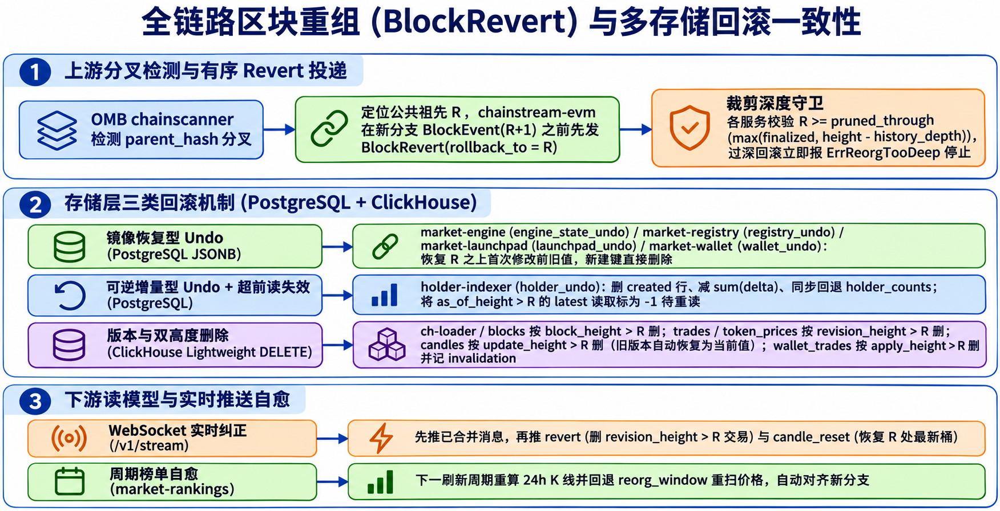
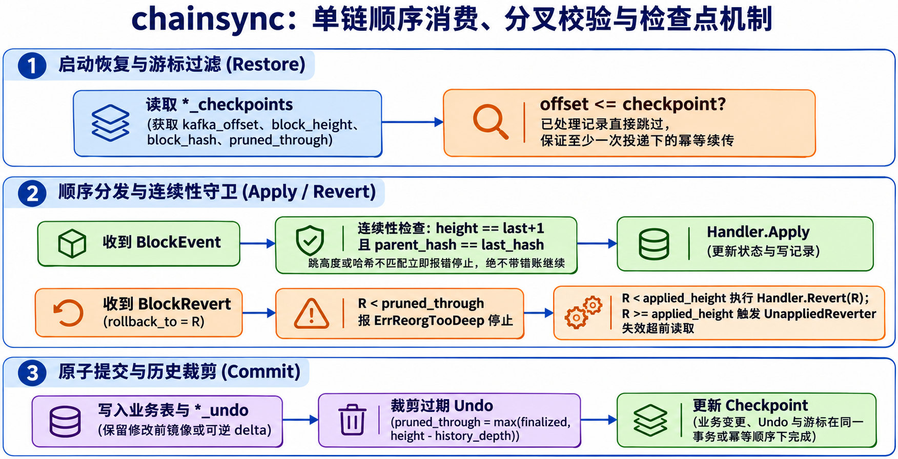

# 全链路区块重组（Reorg）与多存储回滚一致性专题

区块链网络在未达到最终确定性（Finalized）之前随时可能发生分叉重组（Reorg）。如果为了规避重组而只消费 Finalized 区块，行情、K 线、持有人和聪明钱信号的延迟会高达数分钟甚至十几分钟；如果立即消费最新区块却不具备精确回滚能力，每次分叉都会在数据库里永久留下幽灵成交、错误价格和虚增余额。

`chainstream-market` 的核心设计原则是：**零等待跟随最新链头，并在收到 `BlockRevert` 时跨所有服务、双数据库（PostgreSQL + ClickHouse）和实时 WebSocket 连接执行精确、幂等的状态回滚。**



---

## 1. 上游分叉检测与 `chainsync` 连续性守卫

### 1.1 `BlockRevert` 是如何产生并保证顺序的？

1. **父哈希锚点检测**：上游 `oh-my-blockchain`（OMB）的 `chainscanner` 在内存中维护最近 `scanner.cache_size` 个区块的 `(height, hash, parentHash)` 滑动窗口。当新块 $H$ 的 `parentHash` 与本地已发布块 $H-1$ 的 `hash` 不一致时，沿父哈希向后回溯找到公共祖先高度 $R$。
2. **先发 Revert，后发新分支**：`chainstream-evm` 向单分区 Kafka Topic（或 protojson 文件）严格按以下顺序写入记录：
   ```text
   BlockRevert { chain_id: 1, rollback_to: R }
   BlockEvent  { chain_id: 1, block_height: R + 1, parent_hash: hash(R), ... }
   BlockEvent  { chain_id: 1, block_height: R + 2, ... }
   ```
3. **至少一次投递与重复容忍**：由于 Kafka 发送与上游 Redis 游标提交无法跨系统原子完成，上游采用“先发消息、后更游标”策略，并通过 pending revert 机制保证崩溃恢复或“回滚之上再回滚”时绝不漏发 `BlockRevert`。下游可能收到重复的 `BlockEvent` 或重复的 `BlockRevert`。

### 1.2 `chainsync.Engine` 的四道防线



所有消费原始链 Topic 的五个服务（`market-engine`、`holder-indexer`、`market-registry`、`market-launchpad`、`ch-loader`）都通过 [internal/pkg/chainsync/engine.go](../../internal/pkg/chainsync/engine.go) 驱动各自业务层的 `Handler`：

| 防线 | 判定条件 | 行为与原因 |
| --- | --- | --- |
| **1. Offset 幂等过滤** | `message.Offset <= checkpoint.Offset` | 直接跳过，不调用 `Apply` / `Revert` / `Commit`。保证重启或重平衡后从 `Offset + 1` 安全续传。 |
| **2. 重复区块跳过** | `BlockEvent.block_height <= checkpoint.Height` | 视为上游重试导致的重复投递，记 Debug 日志后跳过，仅在 `Commit` 中推进 `checkpoint.Offset`。 |
| **3. 高度与父哈希严格连续性** | `height != checkpoint.Height + 1` 或 `(checkpoint.Hash != "" && block.ParentHash != checkpoint.Hash)` | 立即返回 `ErrHeightGap` 或 `ErrParentMismatch` **停止引擎**，绝不带着缺失块或错位分叉的数据继续运行。 |
| **4. 回滚后清空锚点哈希** | 收到 `BlockRevert{rollback_to: R}` 且 `R < checkpoint.Height` | 调用 `Handler.Revert(R)`，将 `checkpoint.Height` 设为 $R$，并将 **`checkpoint.Hash` 清空为 `""`**。随后到达的替换块 $R+1$ 只校验 `height == R + 1`，并用自己的 `block_hash` 重新建立新的分支哈希链。 |

> [!IMPORTANT]
> **当 `rollback_to >= checkpoint.Height` 时会发生什么？**
> 对于普通 `Handler`，已应用高度还没有超过 $R$，因此没有已落库的块需要撤销，视为空操作（仅推进 `Offset`）。但对于默认使用 `state_reads: latest` 的 `holder-indexer`，即使当前只应用到块 100，它在处理块 100 时可能已经从节点超前读到了旧分支块 102 的余额（`as_of_height = 102`）。因此 `chainsync` 会调用可选接口 `UnappliedReverter.RevertUnapplied(ctx, R)`，让 `holder-indexer` 将所有 `as_of_height > R` 的超前读取立即标记为 `-1`（待重读）。

---

## 2. 八大组件重组回滚与崩溃恢复全景对比

下表汇总了全部 8 个组件在遇到区块重组（回滚到高度 $R$）与进程崩溃重启时的一致性机制：

| 组件 | 存储引擎 | 状态/Undo 表 | 回滚机制（`Revert(R)`） | 崩溃恢复幂等机制 | 历史裁剪边界 |
| --- | --- | --- | --- | --- | --- |
| **`market-engine`** | ClickHouse + PostgreSQL（可选 memory） | PG `engine_state`、`engine_state_undo` | 内存 journal 逐块逆序恢复；PG 用 `block_height > R` 最早旧值恢复或删键；CH 按 `block_height > R` 删 `blocks`、按 `revision_height > R` 删 `trades`/`token_prices`、按 `update_height > R` 删 `candles`；发 live `revert` + `candle_reset` | CH 输出在 PG 检查点提交前写入；重启重放未提交块时先删同高度旧输出再重写 | `max(finalized, H - market.history_depth)`（默认 256） |
| **`ch-loader`** | ClickHouse | 无 Undo 表（原始事实天然可按高度切齐） | 丢弃内存 `pending` 中 $> R$ 的块；CH 五张事实表执行 `DELETE WHERE chain_id = ? AND block_height > R`，追加新检查点 | 先写五张事实表，最后写 `raw_checkpoints`；重启后首块先删 `>= 当前高度` 残留数据再插入 | 无深度限制（支持任意深度回滚） |
| **`holder-indexer`** | PostgreSQL | PG `holder_undo` | 同事务内：① 删 `block_height > R AND created = true` 的新建行；② 减去 `sum(delta)` 并恢复最早 `prev_verified` / `prev_as_of` / `prev_as_of_hash`；③ 同步回退 `holder_counts`；④ 将 `as_of_height > R` 标为 `-1` | 余额、人数、Undo、Checkpoint 在同一个 PG 事务内原子提交 | `max(finalized, H - holders.history_depth)`（默认 256） |
| **`market-registry`** | PostgreSQL | PG `registry_undo` | 同事务内：取 `block_height > R` 中每个 `(kind, key)` 最早的 `prev` JSONB；`prev IS NULL` 则删行，否则写回旧行镜像，再删已消费 Undo | `registry_tokens`、`registry_pools`、Undo、Checkpoint 在同一 PG 事务原子提交 | `max(finalized, H - registry.history_depth)`（默认 256） |
| **`market-launchpad`** | PostgreSQL | PG `launchpad_undo` | 同事务内：按 `launchpad_undo` 恢复 `block_height > R` 最早的 `launchpad_tokens` 旧行镜像（`prev IS NULL` 则删行），更新 `launchpad_heads` 并重算协议集合 | 代币行、head、Undo、Checkpoint 在同一 PG 事务原子提交；重建内存 `trading_pool_id` 映射 | `max(finalized, H - launchpad.history_depth)`（默认 256） |
| **`market-wallet`** | ClickHouse + PostgreSQL | PG `wallet_undo`、`wallet_pending_invalidations` | 先记 `wallet_pending_invalidations`，删 CH `apply_height > R` 的 `wallet_trades`，写 CH `wallet_invalidations`；再在 PG 事务中用 `wallet_undo` 恢复 `wallet_positions` 并更新检查点 | 先写 CH `wallet_trades` 后写 PG 事务；重启按 checkpoint `(height, part)` 删除 CH 多余流水并补发未完成的 pending invalidation | `max(finalized, H - wallet.history_depth)`（默认 256，按 `apply_height`） |
| **`market-rankings`** | PostgreSQL（读 CH + PG） | PG `ranking_checkpoints` | 不消费流；下一刷新周期（默认 15s）重算链头 24h K 线，并从 `last_head_time - reorg_window` 重新扫描 `token_prices`，被回滚掉最新价的代币自动回退到旧价或移出 | 整个榜单的刷新与 `ranking_checkpoints` 在单个 PG 事务内完成 | `rankings.reorg_window`（默认 10m） |
| **`market-api`** | 无写库（读 CH + PG + live topic） | 内存 Hub 状态 | Hub 在收到 live `revert` 时先刷出已合并的节流消息，再向所有订阅该链的 WebSocket 客户端广播 `revert` 与每个受影响序列的 `candle_reset` | 无持久化写状态；慢客户端超出 `client_buffer` 以 `1013` 断开触发客户端重连与 REST 重载 | 跟随 `market-engine` 的实时纠正流 |

---

## 3. 存储层三类回滚范式深度对比

为什么不同组件在数据库里采用了截然不同的 Undo 与删除结构？这取决于业务状态是**复杂结构体的覆盖更新**、**高频大基数数值累加**还是**不可变/多版本时间序列**。

### 3.1 范式一：PostgreSQL JSONB 首次修改前镜像（First-Before-Image Undo）

**适用组件**：`market-engine`（`engine_state_undo`）、`market-registry`（`registry_undo`）、`market-launchpad`（`launchpad_undo`）、`market-wallet`（`wallet_undo`）。

以 `market-registry` 或 `market-wallet` 为例，一行记录包含十几个字段（名称、精度、池子储备、曲线进度、持仓均价、首次买入时间等），有的更新是取最大值、有的是条件覆盖、有的是清零。如果试图为每个字段设计“反向数学运算”，不仅极易出错，而且像“清仓把 `opened_at` 置空”这种有损操作根本不可逆。

因此这四个组件统一采用**块级首次修改前镜像**：

```sql
INSERT INTO wallet_undo (chain_id, block_height, wallet, token, prev)
VALUES ($1, $2, $3, $4, $5)
ON CONFLICT (chain_id, block_height, wallet, token) DO NOTHING;
```

- **块内多次修改只记一次**：如果同一个区块内（或同一个 `apply_height` 的多个分片内）同一个钱包连续买卖同一代币 5 次，第一次修改前把旧行序列化为 JSONB 存入 `prev`（若该行是本块新建的，则 `prev = NULL`）；后续 4 次修改因主键冲突 `DO NOTHING`，不会用中间态覆盖块前真值。
- **跨多块回滚取最早镜像**：当从高度 105 回滚到 100 时，若某键在块 102 和块 104 都被改过，回滚查询通过 `DISTINCT ON (key) ... WHERE block_height > 100 ORDER BY key, block_height ASC` 取出 **块 102 保存的 `prev`**（即块 100 结束时的状态）：
  - 若最早的 `prev IS NULL`，说明该键是在 $> 100$ 的块里才新建的，直接 `DELETE`；
  - 若最早的 `prev IS NOT NULL`，直接反序列化覆盖回主表。

### 3.2 范式二：PostgreSQL 可逆增量（Reversible Delta Undo）+ 超前读失效

**适用组件**：`holder-indexer`（`holder_undo`）。

持有人余额表规模极大，但核心状态只有 `balance`（`NUMERIC(78,0)`）和两个读取坐标（`verified_height`、`as_of_height` / `as_of_hash`）：

- 每个区块对已有持仓只存净变化量 `delta`（可正可负）和修改前的坐标 `prev_verified`、`prev_as_of`、`prev_as_of_hash`；对新建持仓标 `created = true`。
- 回滚到 $R$ 时，先删除 `block_height > R AND created = true` 的行，再对剩余行执行 `balance = balance - SUM(delta)`，并恢复 `block_height > R` 中最小块高记录的旧坐标。
- 同时利用 zero-crossing 规则（回滚前 `balance > 0` 与回滚后 `balance > 0` 的变化）在同一个 SQL 事务里精确增减 `holder_counts`。

### 3.3 范式三：ClickHouse 多时间线删除与 K 线多版本自动回退

**适用组件**：`market-engine`、`ch-loader`、`market-wallet`。

ClickHouse 不适合逐行高频事务更新，因此在 ClickHouse 中**所有回滚都转化为按高度列的轻量级 `DELETE`**，但不同表使用的高度列含义完全不同：

| ClickHouse 表 | 业务时间线列 | 回滚删除列（`DELETE WHERE chain_id = ? AND <col> > R`） | 为什么不能用 `block_height > R` 删除？ |
| --- | --- | --- | --- |
| `raw_*`、`asset_facts`、`pool_facts`、`blocks` | `block_height` | `block_height > R` | 原始事实与块完成标记不发生跨块迟到回填，两个高度合一。 |
| `trades`、`token_prices` | `block_height`（事件发生块） | **`revision_height > R`**（实际写出块） | 假设块 90 的新币交易缺精度被挂起，直到块 102 才拿到精度并回填写出（`block_height = 90, revision_height = 102`）。当链回滚到 100 时，块 102 带来的精度已经不存在了，必须把这笔在块 102 写出的回填数据删掉，并让它退回挂起状态！ |
| `candles` | `open_time`（K 线桶时间） | **`update_height > R`**（桶版本生成块） | 每当一个块修改了某个 K 线桶，都会追加写入一行带当前块高 `update_height` 的完整桶版本（读取时用 `argMax(..., update_height)`）。回滚到 $R$ 时删掉 `update_height > R` 的新版本，**$R$ 及之前写入的旧版本天然重新成为最新值**，彻底免去了对 `high` / `low` 做不可逆反推的难题。 |
| `wallet_trades` | `block_height`（成交发生块） | **`apply_height > R`**（账本记账块） | 对应上游 `trades.revision_height`，保证迟到回填的成交随写出块一起回滚，并通过 `wallet_invalidations` 触发对应 `block_time` 所在日期的 `wallet_token_daily` 重算。 |

---

## 4. 历史裁剪深度（`history_depth`）与 `ErrReorgTooDeep`

所有维护 `*_undo` 表的组件都不会无限保留撤销历史。每当应用一个高度为 $H$、上游报告最终确定高度为 $F$（`finalized_height`）的区块时，都会通过 [internal/pkg/chainsync/prune.go](../../internal/pkg/chainsync/prune.go) 计算新的裁剪水位：

$$\text{pruned\_through}' = \max\left(\text{pruned\_through},\; F,\; H - \text{history\_depth}\right)$$

并将 `block_height <= pruned_through'` 的 `*_undo` 记录删除。

- **单调不减**：`pruned_through` 只增不减，并持久化在各自的 `*_checkpoints` 表中。
- **安全边界**：当收到 `BlockRevert{rollback_to: R}` 时，如果 $R < \text{pruned\_through}$，说明要回滚的区块对应的 Undo 记录已经被裁剪删除。此时组件**立即返回 `ErrReorgTooDeep` 并停止进程**，绝不静默跳过或带着损坏状态继续运行。
- **配置对齐原则**：所有组件的 `history_depth`（默认均为 `256`）必须满足：
  $$\text{history\_depth} \ge \text{chainstream-evm 的 } \texttt{scanner.cache\_size}$$
  并且 ClickHouse 的 `candle_compact_days`（折叠旧 K 线多版本的天数，默认至少数天）也必须远大于最大可能重组的时间跨度。
