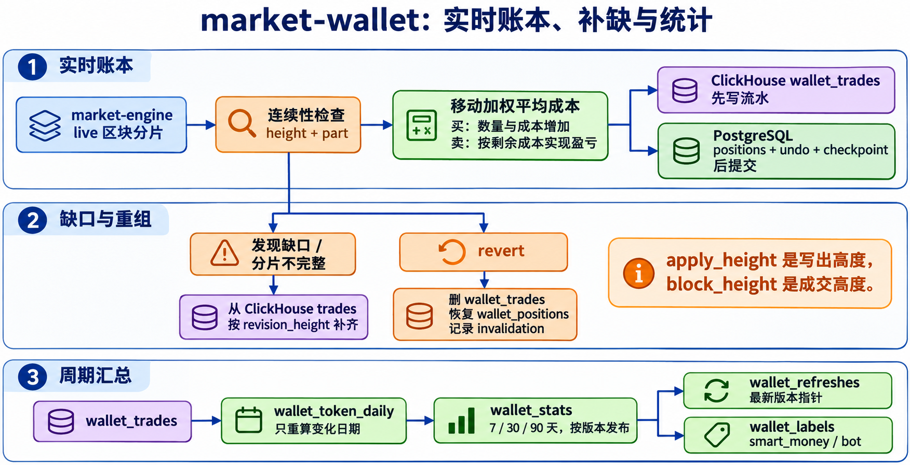
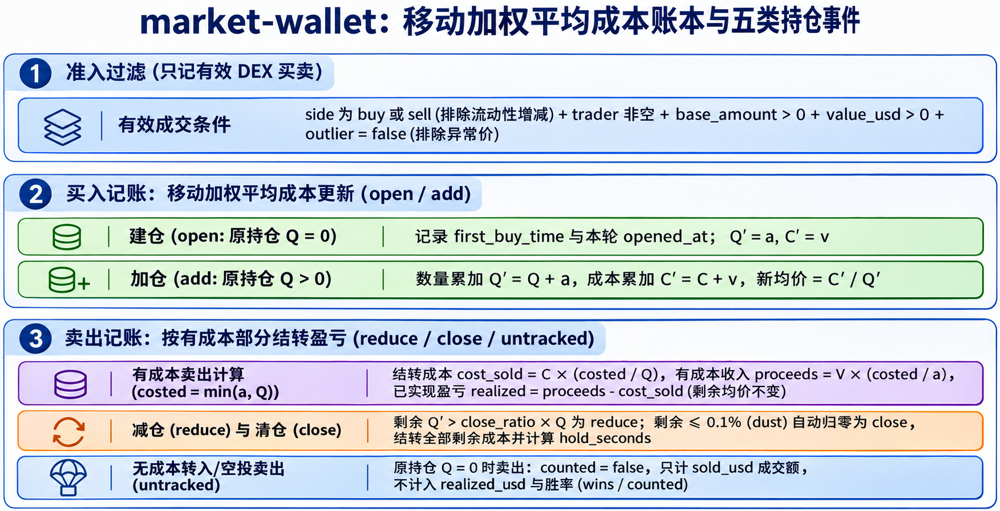
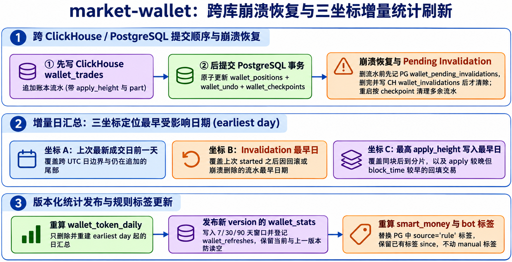

# 钱包成本账本、Live 追块补缺与聪明钱统计专题

本文深入拆解 `market-wallet` 如何基于 `market-engine` 的派生行情流，构建**钱包 × 代币移动加权平均成本账本**、处理 **Kafka Live 分片与 ClickHouse 历史补缺**、保证**跨 PostgreSQL / ClickHouse 崩溃与重组一致性**，并在不扫描全量历史的前提下完成**增量日汇总与聪明钱（`smart_money`）/ 机器人（`bot`）标签计算**。

若只需速查表字段字典与基础配置，可先读 [market-wallet 组件手册](components/market-wallet.md)；本文聚焦算法推演、跨库状态机与边界条件。



---

## 1. 为什么钱包账本不直接读链上余额或 ERC-20 转账？

在链上数据分析中，很容易把以下三套数据混为一谈：

| 维度 | `holder-indexer` (`holder_balances`) | `ch-loader` (`raw_transfers`) | `market-wallet` (`wallet_positions` / `wallet_trades`) |
| --- | --- | --- | --- |
| **核心问题** | 某地址现在链上持有多少代币？ | 某代币发生过哪些 ERC-20 转移日志？ | **某交易者在 DEX 买卖某代币赚了还是亏了多少 USD？** |
| **数据来源** | 链 Topic `transfers` + 节点 `balanceOf` / `getEthBalance` | 链 Topic 原始 `transfers` | `market-engine` 已定方向、已计 USD、已过滤异常价的 `trades` |
| **身份主体** | `holder`（转账接收方 / 余额持有人） | `from_address` / `to_address` | `trader`（交易发起方 `tx.from`） |
| **空投 / 转入** | 计入真实链上余额 | 记录原始 Transfer | **无买入成本**；后续卖出记为 `untracked`（计成交额、不计盈亏） |
| **精度与单位** | `NUMERIC(78,0)` 原始最小单位 | `UInt256` 原始最小单位 | `Decimal` 人类可读单位 + 18 位小数 USD 成本与盈亏 |

之所以不能用 `holder_balances` 或 `raw_transfers` 算盈亏：

1. **一笔路由 Swap 含多跳 Transfer**：用户在 Uniswap 聚合路由用 USDT 买 PEPE，中间可能经过 `USDT -> WETH -> PEPE` 多笔 ERC-20 `Transfer`，且接收方可能是路由合约或代理合约；只有 `market-engine` 解析出的池操作才具备明确的 `trader`、`side`（买/卖）、`base_token` 与当时的公允 `value_usd`。
2. **异常池成交会污染利润**：薄流动性池里一笔偏离公允价 100 倍的闪电贷或操纵交易，若直接入账，会凭空造出“盈利数百万美元的假聪明钱”。`market-wallet` 严格只接纳 `market-engine` 判定 `outlier = false` 且 `value_usd > 0` 的买卖。
3. **转入与空投没有链上 USD 买入成本**：把别的钱包转进来的代币卖掉，如果不区分“有成本持仓”与“无成本数量”，要么会把全部卖出收入当成纯利润（虚增胜率与 PnL），要么会扣出负持仓。

---

## 2. 移动加权平均成本法与五类持仓事件推演



### 2.1 准入条件（`tracked`）

代码位于 `internal/app/wallet/biz/ledger.go` 的 `tracked(trade Trade)`。一笔成交进入账本必须同时满足：

- `side` 为 `buy` 或 `sell`（LP 添加/移除流动性 `liquidity_added` / `liquidity_removed` 不进入账本）；
- `trader != ""` 且 `base_token != ""`；
- `base_amount > 0` 且 `value_usd > 0`；
- `outlier == false`。

### 2.2 买入与卖出的数学定义

对每个 `(chain_id, wallet, token)`，账本维护当前有成本持仓数量 $Q$（`quantity`）和对应剩余总成本 $C$（`cost_usd`，保留 18 位小数）：

1. **买入（`side = buy`，数量 $a$，USD 价值 $v$）**：
   - 若原持仓 $Q = 0$：事件为 **`open`（建仓）**，设置本轮建仓时间 `opened_at = block_time`；若此前从未买过（`first_buy_height == 0`），同时记录 `first_buy_height` 与 `first_buy_time`。
   - 若原持仓 $Q > 0$：事件为 **`add`（加仓）**，`opened_at` 保持本轮首次建仓时间不变。
   - 买入后：
     $$Q' = Q + a, \quad C' = C + v, \quad \text{平均持仓成本} = \frac{C'}{Q'}$$

2. **卖出（`side = sell`，数量 $a$，USD 价值 $V$）**：
   - 无论是否有持仓，`sold_qty` 总是增加 $a$，`sold_usd` 总是增加 $V$，`sells` 计数加 1。
   - **情况 A：无成本持仓卖出（$Q = 0$）**
     - 事件记为 **`untracked`**，`counted = false`，`realized_usd = 0`，`cost_sold_usd = 0`。不增加 `wins` 或 `losses`。
   - **情况 B：有成本持仓卖出（$Q > 0$）**
     - 先取本次可匹配成本的数量：`costed = min(a, Q)`。
     - 检查卖出后剩余比例是否触发尾仓清仓（`closing`）：
       $$Q - \text{costed} \le Q \times \text{close\_ratio} \quad (\text{默认 } \text{close\_ratio} = 0.001)$$
       若触发 `closing`，则令 `costed = Q`，`cost_sold = C`（把尾仓数量和剩余成本一次性全部结转，防止浮点或换币舍入留下的粉尘零头让仓位永远处于 `open`）。
     - 若未触发 `closing`（即 **`reduce` 减仓**），按比例结转成本：
       $$\text{cost\_sold} = \text{round}_{18}\left(C \times \frac{\text{costed}}{Q}\right)$$
       注意减仓后剩余成本 $C' = C - \text{cost\_sold}$、剩余数量 $Q' = Q - \text{costed}$，**剩余持仓的平均成本 $\frac{C'}{Q'}$ 保持不变**。
     - 计算有成本部分对应的卖出收入 `proceeds`：
       - 当 $a \le Q$ 时，整笔卖出都有成本支撑：$\text{proceeds} = V$；
       - 当 $a > Q$ 时（例如账本买过 100 个，又从外部转入 50 个，然后一次性卖出 150 个），只按有成本部分分摊收入：
         $$\text{proceeds} = \text{round}_{18}\left(V \times \frac{\text{costed}}{a}\right)$$
         多卖出的 50 个只计入 `sold_qty` / `sold_usd`，不虚增已实现盈亏。
     - 已实现盈亏与胜负计数：
       $$\text{realized\_usd} = \text{proceeds} - \text{cost\_sold}, \quad \text{counted} = \text{true}$$
       若 $\text{realized\_usd} > 0$ 则 `wins++`，否则（含等于 0）`losses++`。
     - 若触发 `closing`，事件记为 **`close`（清仓）**，记录本轮持仓时长 `hold_seconds = max(block_time - opened_at, 0)`，并将 `quantity = 0, cost_usd = 0, opened_at = NULL`。

### 2.3 完整数值推演案例

假设钱包 `0xAlice` 在某代币上的 `close_ratio = 0.001`（0.1%），依次发生以下 6 笔链上动作：

| 步骤 | 区块时间 | 动作 | 成交数量 $a$ | 成交额 $V$ (USD) | 单价 | 事件 (`event`) | `counted` | 本笔结转成本 `cost_sold` | 本笔有成本收入 `proceeds` | 本笔实现盈亏 `realized_usd` | 交易后 `quantity` ($Q'$) | 交易后 `cost_usd` ($C'$) | 交易后均价 | 累计 `wins` / `losses` |
| --- | --- | --- | --- | --- | --- | --- | --- | --- | --- | --- | --- | --- | --- | --- |
| 1 | `10:00:00` | 空投获得 200 并卖出 200 | 200 | \$200 | \$1.00 | `untracked` | `false` | \$0 | \$0 | \$0 | 0 | \$0 | — | 0 / 0 |
| 2 | `10:05:00` | DEX 买入 | 1,000 | \$1,000 | \$1.00 | `open` | `false` | \$0 | \$0 | \$0 | 1,000 | \$1,000 | \$1.00 | 0 / 0 |
| 3 | `10:10:00` | DEX 买入 | 1,000 | \$2,000 | \$2.00 | `add` | `false` | \$0 | \$0 | \$0 | 2,000 | \$3,000 | \$1.50 | 0 / 0 |
| 4 | `10:15:00` | DEX 卖出 | 500 | \$1,250 | \$2.50 | `reduce` | `true` | \$750 | \$1,250 | **+\$500** | 1,500 | \$2,250 | \$1.50 | 1 / 0 |
| 5 | `10:20:00` | DEX 卖出（仅剩 1 个粉尘，占比 $1/1500 \le 0.1\%$） | 1,499 | \$1,499 | \$1.00 | `close` | `true` | **\$2,250**（全额结转） | \$1,499 | **-\$751** | **0**（粉尘归零） | **\$0** | — | 1 / 1 |
| 6 | `10:30:00` | 重新买入 100，外部转入 100，随后一次卖出 200 | 买 100 (\$100) 后卖 200 (\$400) | \$400 | \$2.00 | `open` → `close` | `true` | \$100 | **\$200** ($\frac{100}{200}\times 400$) | **+\$100** | 0 | \$0 | — | 2 / 1 |

从推演可以看到三个关键设计细节：

- **步骤 1（`untracked`）**：空投卖出不会记成 +\$200 利润，也不会影响胜率。
- **步骤 5（`close_ratio` 粉尘清仓）**：卖出 1,499 后仅剩 1 个代币（占原持仓 1,500 的 $0.0667\% \le 0.1\%$），系统直接按 `close` 清仓，把剩余 \$2,250 成本全部结转，并结算本轮 `hold_seconds = 10:20:00 - 10:05:00 = 900s`。
- **步骤 6（混合成本与外部转入的一次性卖出）**：有成本持仓只有 100 个，卖出 200 个获得 \$400 时，只有 $100/200 = 50\%$ 的收入（\$200）与 \$100 成本配对算出 +\$100 利润，完美防止通过“买一点点 + 转入大量代币卖出”刷高已实现盈亏。

---

## 3. 跟读 Live Topic、区块分片（`part/parts`）与 ClickHouse 补缺

`market-wallet` 的实时跟读器（`internal/app/wallet/biz/follower.go`）不是直接消费原始链 Topic，而是消费 `market-engine` 发出的 `{topic}-live`。这带来了三个必须解决的工程问题：

### 3.1 为什么一个区块会有多个 `part`？

当某个区块包含大量成交（或触发了迟到小数位历史回放）时，`market-engine` 会把同一个区块的实时消息拆成多个分片发往 Kafka live topic，每条消息携带：

- `height`：写出该消息的区块高度（即 `market-engine` 的 `revision_height`）；
- `part`：当前分片序号（从 `0` 开始：`0, 1, ..., parts-1`）；
- `parts`：该区块的总分片数。

而当 `market-wallet` 从 ClickHouse `trades` 表按高度回放或补缺时，读取到的是该高度的完整成交集合，内部记为 `part = -1`（常量 `WholeBlock`）。

### 3.2 四种不连续场景与自动补缺状态机

`market-engine` 为了不在追块期间冲击 WebSocket 客户端，在 live topic 上**会跳过落后墙钟超过 `live.max_lag`（默认 10m）的旧区块**。因此 `market-wallet` 在跟读 live topic 时，遇到高度缺口是常态，不能直接报错停止，而是与 ClickHouse `trades` 表协同补缺：

| 场景 | 触发条件 | `follower` 的处理动作 |
| --- | --- | --- |
| **1. 首次冷启动** | `wallet_checkpoints` 无该链记录 | 先从 ClickHouse 回放最近 `wallet.history`（默认 90 天）内的历史成交，再从 live topic 末尾等待第一个 `part == 0` 的新区块接续。 |
| **2. 正常跨块缺口** | 上一块已完整收齐（`part == -1` 或 `part == parts - 1`），新消息 `height > checkpoint.Height + 1` | 先按 `revision_height` 从 ClickHouse `trades` 批量补齐 `[checkpoint.Height + 1, height - 1]` 的所有区块（记为 `WholeBlock`），再应用当前新消息。每次补缺使指标 `wallet_backfills_total` 加 1。 |
| **3. 前一块分片未收齐就来了新块** | `checkpoint.Part >= 0 && checkpoint.Part + 1 < checkpoint.Parts`，却收到了更高块 `height > checkpoint.Height` | 说明 `market-engine` 在发布前一块中途崩溃，重启后因该块超过 `live.max_lag` 跳过了剩余分片。`follower` **先将不完整的前一块 `Revert` 到 `checkpoint.Height - 1`**，再从 ClickHouse 一次性把前一块和中间缺口全部按完整块补齐！ |
| **4. 同一块内分片乱序或跳号** | 同一 `height` 下收到的 `part != expectedPart`（且不是已处理过的重复分片） | 属于非法流状态，返回错误停止服务，防止漏记同块内的成交。 |

---

## 4. 跨 ClickHouse / PostgreSQL 提交顺序与崩溃恢复



`market-wallet` 同时写 ClickHouse（`wallet_trades` 流水表）和 PostgreSQL（`wallet_positions` 持仓表、`wallet_undo` 撤销表、`wallet_checkpoints` 检查点表）。两个异构数据库之间没有分布式 2PC 事务，系统通过**固定写入顺序 + 启动幂等清理 + Pending Invalidation 两阶段登记**保证强一致。

### 4.1 正常 Flush 顺序：先写流水，后提交账本与检查点

在 `internal/app/wallet/data/ledger.go` 中，每次 Flush 严格按以下顺序执行：

```text
第 1 步：ClickHouse INSERT INTO wallet_trades (...)
第 2 步：PostgreSQL BEGIN TX
          ├─ Upsert wallet_positions
          ├─ Insert wallet_undo (ON CONFLICT DO NOTHING，仅保留该 apply_height 首次修改前镜像)
          ├─ Delete 过期的 wallet_undo (block_height <= pruned_through)
          └─ Upsert wallet_checkpoints (kafka_offset, block_height, part, parts, pruned_through)
        COMMIT TX
```

**如果在第 1 步和第 2 步之间进程崩溃会怎样？**

- ClickHouse 中已经写入了 `checkpoint` 之后的 `wallet_trades`，但 PostgreSQL 的 `wallet_positions` 和 `wallet_checkpoints` 仍停留在旧位置。
- 下次启动时，`Restore` 读取 `wallet_checkpoints` 得到最后提交的 `(block_height, part)`，在消费任何新消息前**先删除 ClickHouse 中晚于该坐标的残留流水**：
  - 若 `checkpoint.Part >= 0`（停在某块中间分片）：删除 `apply_height > H OR (apply_height = H AND part > P)` 的流水；
  - 若 `checkpoint.Part == -1`（停在完整块）：删除 `apply_height > H` 的流水。
- 清理完毕后从 `checkpoint.Offset + 1` 重新消费，流水和持仓恢复严格一致，绝不会重复记账。

### 4.2 为什么需要 `wallet_pending_invalidations`？

当发生区块重组（`Revert`）或启动恢复删除了 ClickHouse 中的 `wallet_trades` 时，周期统计任务（`StatsRefresher`）必须知道“被删掉的这些流水最早影响了哪一天的日汇总（`wallet_token_daily`）”，否则旧分支在更早日期产生的日汇总会残留在表里。

但“查询待删流水的最早日期 → 执行 ClickHouse DELETE → 写入 ClickHouse `wallet_invalidations`”同样跨越多个步骤。如果先删了 ClickHouse 流水，还没来得及写 `wallet_invalidations` 就崩溃了，重启后因为流水已经没了，再查待删范围就会得到空集，导致**丢失统计失效通知**！

为此系统设计了 PostgreSQL `wallet_pending_invalidations` 表：

1. **删除流水前**：先从 ClickHouse 查出待删流水的最早成交日 `min(toDate(block_time))`，与保留高度 `afterHeight` 一起写入 PostgreSQL `wallet_pending_invalidations`（若已有记录则合并取更早的 `day` 和更低的 `height`）。
2. **执行删除**：在 ClickHouse 删除对应的 `wallet_trades`。
3. **发布失效并清除 Pending**：把失效范围写入 ClickHouse `wallet_invalidations`（供 `StatsRefresher` 读取），成功后才删除 PostgreSQL 中的 `wallet_pending_invalidations` 行。

即使在步骤 2 和步骤 3 之间崩溃，下次启动或下一次删除操作仍会从 `wallet_pending_invalidations` 读出未发布的失效日期并补发到 `wallet_invalidations`。

---

## 5. 三坐标增量日汇总与版本化统计发布

`wallet_trades` 默认保留 120 天（`wallet.trades_days`）。如果每 15 分钟刷新一次 7 / 30 / 90 天统计都全量扫描 90 天的所有流水，ClickHouse 的 CPU 和 I/O 开销会随钱包数量线性膨胀。

`market-wallet` 将统计拆为两层：**按天预聚合的 `wallet_token_daily`** 与 **按窗口汇总的版本表 `wallet_stats`**。

### 5.1 三坐标定位最早受影响日（`earliest day`）

在非首次刷新时，`StatsRefresher`（`internal/app/wallet/biz/stats.go` 与 `data/stats.go`）只重算 `[earliest, latest_trade_day]` 范围内的 `wallet_token_daily`。`earliest` 取以下三个候选日期中的**最早者**（并截断在最大窗口 90 天内）：

1. **坐标 A（跨日与尾部保护）**：`上次刷新看到的最新成交日 (last.head_time) - 1 天`
   - 保证上次刷新时尚未结束的那一天，以及跨 UTC 零点边界的交易一定被重新汇总。
2. **坐标 B（回滚与恢复失效保护）**：`wallet_invalidations 中 at >= last.started 的最早 day`
   - 覆盖自上一轮统计**开始读取（`last.started`）**以来，因区块回滚或崩溃恢复被删掉的流水最早影响的成交日。
3. **坐标 C（迟到回填与同块后续分片保护）**：`wallet_trades 中 apply_height >= last.apply_height 的最早 toDate(block_time)`
   - 覆盖两类关键边界：
     - **同块后到的分片**：上一轮刷新时块 $H$ 只写到了 `part=0`，刷新结束后块 $H$ 的 `part=1` 才写入（所以必须用 `>= last.apply_height` 而非 `>`）；
     - **迟到小数位回填**：`market-engine` 在块 1000 才学到某代币精度，回填了块 200（3 天前）的交易；这笔流水的 `apply_height = 1000`，但 `block_time` 在 3 天前。坐标 C 能精准捕获到 3 天前那一天并重算其日表！

### 5.2 版本化 `wallet_stats` 与无锁读取

日表 `wallet_token_daily` 更新后，系统以最新成交所在的 UTC 日为窗口终点，汇总生成 7 / 30 / 90 天的 `wallet_stats`：

- 每次刷新分配一个单调递增的毫秒时间戳 `version`，`wallet_stats` 按 `(chain_id, version)` 物理分区。
- 所有窗口的 `wallet_stats` 行写完后，才向 `wallet_refreshes` 写入该 `version`。
- `market-api` 查询钱包榜单或画像时，先从 `wallet_refreshes` 读最新 `version`，再按 `version` 查询 `wallet_stats`。因此**刷新过程中 API 看到的是完整的上一代数据，刷新完成后瞬间切换到新一代数据**，无需加锁，也不会读到半成品。
- 新版本发布后，系统调用 `DROP PARTITION` 删除除“当前版本”和“上一版本”之外的旧分区（保留上一版本是为了防止正在执行的并发 API 查询刚拿到旧版本号就被删分区）。

### 5.3 聪明钱（`smart_money`）与机器人（`bot`）判定规则

在每个刷新周期末尾，系统基于最新 `version` 的 `wallet_stats` 自动计算规则标签（`source = 'rule'`）：

| 标签 | 统计窗口 | 判定条件（全部阈值可在 `configs/market-wallet.yaml` 配置） |
| --- | --- | --- |
| **`bot`** | `bot.window_days`（默认 7 天） | 满足其一即可：<br>1. 高频交易：窗口内 `buys + sells >= 2000`（`min_trades`）；<br>2. 快进快出：窗口内清仓次数 `closes >= 10`（`min_closes`），且持仓时长 $\le 60\text{s}$（`fast_close_seconds`）的清仓占比 `fast_closes / closes >= 0.30`（`fast_close_ratio`）。 |
| **`smart_money`** | `smart_money.window_days`（默认 30 天） | 必须同时满足：<br>1. **非机器人**：当前未被判定为 `bot`；<br>2. **绝对收益达标**：窗口内已实现盈亏 `realized_usd >= $5,000`（`min_realized_usd`）；<br>3. **胜率达标**：窗口内有计入盈亏的卖出（`counted > 0`）且胜率 `wins / counted >= 0.50`（`min_win_rate`）；<br>4. **分散度达标**：窗口内交易过的不同代币数 `tokens >= 10`（`min_tokens`），防止单币彩票型运气钱包入选；<br>5. **回撤控制达标**：亏损超过 50% 的代币占比 `tokens_loss_over / tokens <= 0.30`（`max_loss_over_50_ratio`）；<br>6. **名额截断**：按 `realized_usd DESC` 排序取前 `1000` 名（`max_wallets`）。 |

标签写入 PostgreSQL `wallet_labels` 时：
- 只增删 `source = 'rule'` 的标签，外部人工打上的 `source = 'manual'` 标签永远不会被规则引擎覆盖或清除；
- 连续多轮保持入选的钱包，其 `since`（首次获得标签时间）保持不变。

---

## 6. 代码索引

| 模块 | 文件路径 | 核心职责 |
| --- | --- | --- |
| 成本账本算法 | [internal/app/wallet/biz/ledger.go](../../internal/app/wallet/biz/ledger.go) | `tracked` 准入过滤、`record` 移动加权平均成本与五类事件计算 |
| Live 跟读与补缺 | [internal/app/wallet/biz/follower.go](../../internal/app/wallet/biz/follower.go) | 分片连续性检查、ClickHouse 缺口补齐、批量 Flush 与 Revert 编排 |
| 统计与标签编排 | [internal/app/wallet/biz/stats.go](../../internal/app/wallet/biz/stats.go) | 周期触发日表重算、版本发布、标签更新与旧分区清理 |
| 跨库账本持久化 | [internal/app/wallet/data/ledger.go](../../internal/app/wallet/data/ledger.go) | `wallet_trades` 写入、PG 事务提交、崩溃残留清理、`wallet_pending_invalidations` |
| 统计 SQL 与规则 | [internal/app/wallet/data/stats.go](../../internal/app/wallet/data/stats.go) | 三坐标 `earliestDay` 计算、`wallet_token_daily` / `wallet_stats` SQL、`smart_money` / `bot` 筛选 |
| 表结构 DDL | [internal/pkg/pgdb/wallet.go](../../internal/pkg/pgdb/wallet.go)、[internal/pkg/chdb/wallet.go](../../internal/pkg/chdb/wallet.go) | PostgreSQL 与 ClickHouse 钱包相关表的完整定义与索引 |
